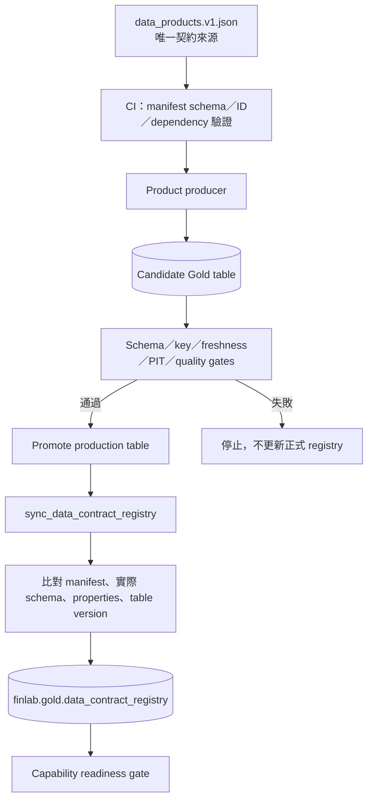
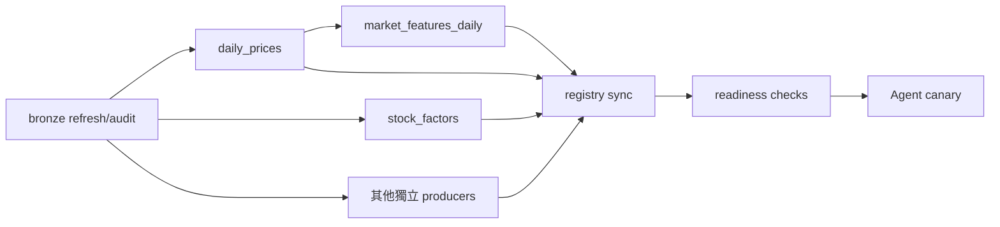

# FinLab Gold Data：Databricks 部署與執行指南

最後更新：2026-10-23

適用：Windows 本機 + Databricks Free Edition/serverless + Unity Catalog

這份指南從 bronze 已存在開始，逐步建立：

```text
finlab.gold.daily_prices                 # Agent 核心價格契約
finlab.gold.stock_factors                # Agent point-in-time 因子契約
finlab.gold.data_contract_registry       # 契約登錄
finlab.gold.forecast_training_features   # 模型訓練資料
```

完整資料契約與未來 Tool 擴充規格見
[`finlab_agent/docs/data-contracts.md`](../finlab_agent/docs/data-contracts.md)。

## 1. 完成後的資料流

```text
finlab.bronze.price --------------------------+
finlab.bronze.*divide/cap ratios ------------+--> materialize_agent_gold
finlab.bronze.monthly_report -----------------+           |
                                                           +--> daily_prices
                                                           +--> stock_factors
                                                           +--> data_contract_registry

bronze price / pe / monthly_report / ratios --> forecast_training_features
                                                           |
                                                           +--> forecast_training_features

daily_prices + stock_factors --> FinLab Agent repositories --> tools
forecast_training_features --> Optuna tuning --> candidate model bundle
```

這四張表不是同一個生命週期：

|資料產品|建議更新|Consumer|
|---|---|---|
|`daily_prices`|交易日 crawler 成功後增量更新；定期 full rebuild|Agent 指標、篩選、回測|
|`stock_factors`|月營收更新後；目前 notebook 每次全量重算|Agent 篩選|
|`forecast_training_features`|月頻或每次模型 candidate 前|tuning/training job|
|`data_contract_registry`|契約或部署更新時|部署檢查、稽核|

## 2. 對應的專案檔案

本機：

```text
finlab_practice/
├─ databricks_migrate/
│  ├─ notebooks/
│  │  ├─ materialize_agent_gold.py
│  │  └─ forecast_training_features.py
│  ├─ databricks_src/
│  │  ├─ tune_forecast_models.py
│  │  └─ train_forecast_models.py
│  └─ requirements-ml.txt
├─ finlab_agent/
│  ├─ app.yaml
│  ├─ src/finlab_agent/repository.py
│  └─ docs/data-contracts.md
└─ docs/
   └─ gold_data_deployment_zh-TW.md
```

建議 Workspace：

```text
/Workspace/Users/<email>/finlab_project/
├─ notebooks/
│  ├─ materialize_agent_gold
│  └─ forecast_training_features
├─ databricks_src/
│  ├─ tune_forecast_models.py
│  └─ train_forecast_models.py
└─ requirements-ml.txt
```

兩支 notebook 必須在 Databricks serverless 執行；不要在本機直接執行，因為它們使用 `spark`、`dbutils`、Delta 與 Unity Catalog。

## 3. 前置檢查

若 Bronze 已經存在且正要部署泛化後的 `DatasetSpec`／`DeltaWriter`，先依
[`bronze_contract_migration_zh-TW.md`](bronze_contract_migration_zh-TW.md) 執行部署前後
唯讀 audit 與單表 canary；不要重新匯入歷史 Parquet。

### 3.1 確認 bronze tables

在 Databricks SQL Editor 執行：

```sql
SHOW TABLES IN finlab.bronze;

DESCRIBE TABLE finlab.bronze.price;
DESCRIBE TABLE finlab.bronze.pe;
DESCRIBE TABLE finlab.bronze.monthly_report;
DESCRIBE TABLE finlab.bronze.otc_cap_reduction;
DESCRIBE TABLE finlab.bronze.twse_cap_reduction;
DESCRIBE TABLE finlab.bronze.otc_divide_ratio;
DESCRIBE TABLE finlab.bronze.twse_divide_ratio;
```

必要最低來源：`price`、`monthly_report`。建立 forecast training table 另需 `pe`。
`require_all_adjustment_sources=true`（預設）時，四張 corporate-action tables 少任何一張，
或任一張沒有可用的正 ratio，都會 fail-fast；只有刻意做 raw-price 開發測試時才應關閉。
Agent 的 MA、動能與回測必須固定 adjustment basis。

確認 key 與日期：

```sql
SELECT
  COUNT(*) AS rows,
  COUNT(DISTINCT STRUCT(stock_id, date)) AS distinct_keys,
  MIN(date) AS min_date,
  MAX(date) AS max_date
FROM finlab.bronze.price;

SELECT
  COUNT(*) AS rows,
  COUNT(DISTINCT STRUCT(stock_id, date)) AS distinct_keys,
  MIN(date) AS min_date,
  MAX(date) AS max_date
FROM finlab.bronze.monthly_report;
```

如果 `rows != distinct_keys`，先修 bronze；不要期待 Gold 任意猜測重複資料應保留哪列。

### 3.2 建立 Gold schema

在 SQL Editor 執行：

```sql
CREATE SCHEMA IF NOT EXISTS finlab.gold;
```

執行 notebook 的使用者／Job principal 需要：

- `USE CATALOG` on `finlab`；
- `USE SCHEMA`, `CREATE TABLE`, `MODIFY` on `finlab.gold`；
- bronze source tables 的 `SELECT`。

Agent App service principal 不需要寫入權限；稍後只授予兩張 consumer tables 的 `SELECT`。

## 4. 本機 CLI 登入與同步

### 4.1 確認新版 CLI

PowerShell：

```powershell
databricks -v
```

若不存在：

```powershell
winget install Databricks.DatabricksCLI
```

使用瀏覽器看到的完整 Workspace host 登入：

```powershell
$workspaceHost = "https://<your-workspace-host>"
$profileName = "finlab-free"

databricks auth login --host $workspaceHost --profile $profileName
databricks current-user me --profile $profileName
```

`current-user me` 必須回傳預期帳號。不要把 token 寫入 repo 或 notebook。

### 4.2 只同步程式

在 `finlab_practice` 根目錄執行：

```powershell
$email = "your.name@gmail.com"
$profileName = "finlab-free"
$workspaceRoot = "/Users/$email/finlab_project"

databricks sync `
  ".\databricks_migrate\notebooks" `
  "$workspaceRoot/notebooks" `
  --exclude "__pycache__" `
  --exclude "*.pyc" `
  --profile $profileName

databricks sync `
  ".\databricks_migrate\databricks_src" `
  "$workspaceRoot/databricks_src" `
  --exclude "__pycache__" `
  --exclude "*.pyc" `
  --profile $profileName

databricks workspace import `
  ".\databricks_migrate\requirements-ml.txt" `
  "$workspaceRoot/requirements-ml.txt" `
  --format AUTO --overwrite `
  --profile $profileName
```

不要 sync 整個 `databricks_migrate`，否則可能上傳本機大型 `export/parquet`。

## 5. 第一次建立 Agent Gold tables

### 5.1 開啟 notebook

1. Databricks 左側選 **Workspace**。
2. 打開 `/Users/<email>/finlab_project/notebooks/materialize_agent_gold`。
3. Compute 選 serverless。
4. 此 notebook 只使用 runtime 內建 PySpark/Delta，不需要 `requirements-ml.txt`。
5. 第一次先用 candidate table names，確認後再寫正式表。

### 5.2 第一次 smoke widgets

|Widget|Smoke 建議|正式值|說明|
|---|---|---|---|
|`catalog`|`finlab`|`finlab`|UC catalog|
|`bronze_schema`|`bronze`|`bronze`|來源 schema|
|`gold_schema`|`gold`|`gold`|目標 schema|
|`price_table`|`daily_prices_candidate`|`daily_prices`|價格資料產品|
|`factor_table`|`stock_factors_candidate`|`stock_factors`|因子資料產品|
|`registry_table`|`data_contract_registry_candidate`|`data_contract_registry`|契約登錄|
|`start_date`|最近 2 年|`2013-01-01` 或完整需求|價格起點|
|`factor_delay_days`|`5`|`5`|發布後保守延遲|
|`adjust_prices`|`true`|`true`|production 應固定 true|
|`minimum_price_rows`|`1000`|依歷史量設定，預設 `10000`|fail-fast|
|`minimum_factor_periods`|`12`|預設 `24`|fail-fast|
|`refresh_mode`|`full`|第一次一定 `full`|重建或 MERGE|
|`incremental_lookback_days`|`14`|`14`|增量重算重疊區|
|`require_all_adjustment_sources`|`true`|`true`|缺任一調整來源即失敗|

按 **Run all**。成功結尾必須看到：

```text
AGENT_GOLD_MATERIALIZATION_OK
```

Notebook 的工作：

1. 驗證來源 table/中文欄位。
2. 正規化 OHLCV。
3. 以四種 ratio 建立一致的 adjusted OHLC。
4. 產生 point-in-time `revenue_mom`／`revenue_yoy`。
5. 檢查 keys、OHLC、期間數與 available-time 規則。
6. 寫 Delta tables 與 table properties。
7. MERGE contract registry。

### 5.3 驗證 candidate

```sql
SELECT *
FROM finlab.gold.daily_prices_candidate
ORDER BY date DESC, stock_id
LIMIT 20;

SELECT *
FROM finlab.gold.stock_factors_candidate
ORDER BY date DESC, stock_id
LIMIT 20;

SELECT *
FROM finlab.gold.data_contract_registry_candidate
ORDER BY product_name;
```

若結果正確，以正式 table names、完整 `start_date`、`refresh_mode=full` 再跑一次。Candidate tables 可保留到驗收完；刪除前先確認沒有任何 App/Job resource 指向它們。

## 6. Agent Gold 驗收 SQL

### 6.1 `daily_prices`

```sql
SELECT
  COUNT(*) AS rows,
  COUNT(DISTINCT STRUCT(date, stock_id)) AS distinct_keys,
  COUNT(DISTINCT adjustment_basis) AS adjustment_bases,
  MIN(date) AS min_date,
  MAX(date) AS max_date,
  SUM(CASE WHEN open <= 0 OR high <= 0 OR low <= 0 OR close <= 0 THEN 1 ELSE 0 END) AS invalid_ohlc,
  SUM(CASE WHEN high < low THEN 1 ELSE 0 END) AS invalid_high_low,
  SUM(CASE WHEN volume < 0 THEN 1 ELSE 0 END) AS invalid_volume,
  SUM(CASE WHEN stock_id_numeric NOT RLIKE '^[0-9]{4,6}$' THEN 1 ELSE 0 END) AS invalid_numeric_id,
  SUM(CASE WHEN is_etf AND stock_id NOT LIKE '00%' THEN 1 ELSE 0 END) AS invalid_etf_flag,
  SUM(CASE WHEN is_etf AND etf_type IS NULL THEN 1 ELSE 0 END) AS unclassified_etf,
  SUM(CASE WHEN name IS NULL OR TRIM(name) = '' THEN 1 ELSE 0 END) AS missing_name
FROM finlab.gold.daily_prices;
```

通過條件：

- `rows = distinct_keys`；
- `adjustment_bases = 1`；
- `invalid_ohlc = 0`；
- `invalid_high_low = 0`；
- `invalid_volume = 0`；
- `invalid_numeric_id = 0`、`invalid_etf_flag = 0`、`unclassified_etf = 0`；
- `missing_name` 應接近 0；正式要求非空前先建立 `security_master/v1` 做名稱主檔；
- `max_date` 符合最近已完成 crawler 的交易日。

抽樣一支有除權息的股票，核對事件前後沒有非經濟性的價格跳空。若 adjustment table 缺資料，不要只看 notebook 成功字樣。

抽樣檢查 identity 與 ETF 分類：

```sql
SELECT stock_id, stock_id_numeric, name, is_etf, etf_type_code, etf_type,
       MIN(date) AS min_date, MAX(date) AS max_date
FROM finlab.gold.daily_prices
GROUP BY ALL
ORDER BY is_etf DESC, stock_id
LIMIT 100;
```

`stock_id` 保留官方完整代號；例如 `00679B` 的 `B` 是正式代號的一部分。
`stock_id_numeric='00679'` 只供搜尋或分組，不可取代 primary key。

### 6.2 `stock_factors`

```sql
SELECT
  COUNT(*) AS rows,
  COUNT(DISTINCT STRUCT(date, stock_id)) AS distinct_keys,
  COUNT(DISTINCT date) AS periods,
  MIN(date) AS min_date,
  MAX(date) AS max_date,
  SUM(CASE WHEN date <> available_at THEN 1 ELSE 0 END) AS invalid_compat_date,
  SUM(CASE WHEN available_at < source_release_date THEN 1 ELSE 0 END) AS lookahead_rows
FROM finlab.gold.stock_factors;
```

通過條件：key 唯一、`invalid_compat_date=0`、`lookahead_rows=0`。前 12 個月的 `revenue_yoy` 為 null 是正常 warm-up，不可用未來值填補。

抽樣核對：

```sql
SELECT date, stock_id, revenue_period_end, source_release_date,
       available_at, revenue, revenue_mom, revenue_yoy
FROM finlab.gold.stock_factors
WHERE stock_id = '2330'
ORDER BY date DESC
LIMIT 24;
```

### 6.3 以 Agent 實際 SELECT 驗證

```sql
SELECT date, stock_id, stock_id_numeric, name, is_etf, etf_type_code,
       open, high, low, close, volume
FROM finlab.gold.daily_prices
WHERE stock_id = '2330'
  AND date BETWEEN DATE '2024-01-01' AND DATE '2024-05-20'
ORDER BY date, stock_id;

SELECT date, stock_id, revenue_yoy
FROM finlab.gold.stock_factors
WHERE stock_id = '2330'
  AND date <= DATE '2024-05-20'
ORDER BY date, stock_id;
```

這兩段就是目前 `DatabricksSqlPriceRepository` 所依賴的欄位集合。

## 7. 日常增量與定期重建

第一次必須 `refresh_mode=full`。之後交易日可使用：

```text
refresh_mode = incremental
incremental_lookback_days = 14
```

`daily_prices/v1 -> v2` 增加 parsed identity／ETF 欄位並擴充官方代號格式，屬於 major
contract migration；部署這版 notebook 後第一次一定要 `refresh_mode=full`。Notebook 會
拒絕把 v2 incrementally MERGE 進既有 v1 table，避免新欄位與舊 `stock_id` 語意混在一起。

增量模式會從目標 `MAX(date) - lookback` 重讀 bronze，重新套用完整 ratio history，再以 `date + stock_id` MERGE。重疊區可吸收最近 crawler 修訂或短期補抓。

限制：超過 lookback 的舊 corporate-action revision 不會被增量模式改寫。因此建議：

- 每個交易日：增量更新；
- 每月或 corporate-action 邏輯變更後：full rebuild；
- adjustment basis 改變：不可增量混寫，建立新 major contract 或 full rebuild。

Notebook 會拒絕把 `raw` batch MERGE 進既有 adjusted table，反之亦然。

## 8. 建立 Forecast Training Gold table

Agent tables 驗收後，再執行：

```text
/Users/<email>/finlab_project/notebooks/forecast_training_features
```

### 8.1 Widgets

|Widget|正式建議|
|---|---|
|`catalog`|`finlab`|
|`bronze_schema`|`bronze`|
|`gold_schema`|`gold`|
|`output_table`|`forecast_training_features`|
|`registry_table`|`data_contract_registry`|
|`start_date`|`2013-01-01`|
|`feature_delay_days`|`5`|
|`adjust_prices`|`true`|
|`minimum_periods`|`48`|
|`require_all_adjustment_sources`|`true`|

這支 notebook 目前完整重建 training snapshot。它含下一期 `return/rank` label，不可授權一般 Agent App 查詢。

驗收：

```sql
SELECT
  COUNT(*) AS rows,
  COUNT(DISTINCT STRUCT(date, stock_id)) AS distinct_keys,
  COUNT(DISTINCT date) AS periods,
  MIN(date) AS min_date,
  MAX(date) AS max_date,
  MIN(rank) AS min_rank,
  MAX(rank) AS max_rank
FROM finlab.gold.forecast_training_features;
```

通過條件：key 唯一、至少 48 期、rank 在 `[0,1]`。最後一個 source month 因未來 label 未知而不出現在 training table 是正常行為。

後續 tuning/training 詳見
[`forecast_feature_and_tuning_automation_zh-TW.md`](forecast_feature_and_tuning_automation_zh-TW.md)。

## 9. Job 設定

### 9.1 Agent Gold refresh Job

在 **Jobs & Pipelines → Create Job**：

1. Job name：`finlab-agent-gold-refresh`。
2. Task type：Notebook。
3. Path：`.../notebooks/materialize_agent_gold`。
4. Compute：serverless。
5. Parameters：正式 table names、`refresh_mode=incremental`、lookback 14。
6. 依賴：必須在 `finlab_daily_update` 成功後執行；若無法跨 Job dependency，排程至少錯開 30 分鐘並加入 freshness gate。
7. Schedule：交易日 crawler 完成後，例如 Asia/Taipei 20:30。
8. Concurrent runs：1。
9. Failure notification：至少通知 notebook failure 與 freshness failure。

每月另執行一次相同 notebook、`refresh_mode=full`。Free Edition 資源不足時可手動執行，並記錄 run ID。

### 9.2 Forecast candidate workflow

建議季度或按需建立三個相依 tasks：

```text
forecast_training_features notebook
              |
              v
tune_forecast_models.py
              |
              v
train_forecast_models.py --params-file <same-run>/best_params.json
```

不要由每日 crawler 自動觸發昂貴 tuning。

## 10. 將 Gold tables 綁定 FinLab Agent

### 10.1 最小權限

在建立 Databricks App 後取得 App service principal，授予：

```sql
GRANT USE CATALOG ON CATALOG finlab TO `<app-service-principal>`;
GRANT USE SCHEMA ON SCHEMA finlab.gold TO `<app-service-principal>`;
GRANT SELECT ON TABLE finlab.gold.daily_prices TO `<app-service-principal>`;
GRANT SELECT ON TABLE finlab.gold.stock_factors TO `<app-service-principal>`;
```

不要授予：

- `forecast_training_features` 的 SELECT；
- bronze tables 的 SELECT；
- gold schema 的 MODIFY/CREATE/OWN。

### 10.2 App resources

在 **Apps → App resources** 加入：

|Resource key|Resource|權限|
|---|---|---|
|`sql-warehouse`|SQL warehouse|CAN USE|
|`price-table`|`finlab.gold.daily_prices`|SELECT|
|`factor-table`|`finlab.gold.stock_factors`|SELECT|
|`chat-model`|支援 tool calling 的 endpoint|CAN QUERY|

Keys 必須和 `finlab_agent/app.yaml` 完全一致。部署後環境會得到：

```text
FINLAB_DATA_BACKEND=databricks
DATABRICKS_WAREHOUSE_ID=<resource value>
FINLAB_PRICE_TABLE=finlab.gold.daily_prices
FINLAB_FACTOR_TABLE=finlab.gold.stock_factors
```

Agent 部署與驗收詳見
[`finlab_agent/docs/databricks-deployment.md`](../finlab_agent/docs/databricks-deployment.md)。

## 11. Agent 端到端驗收

依序詢問：

1. `請告訴我 2330 在 2024-05-20 的收盤價、MA20、MA60 與價格動能。`
2. `截至 2024-05-20，找出營收年增率大於 15% 且價格高於 MA60 的股票。`
3. `用 tw_ma20_60 回測 2024-01-02 到 2024-05-20。`

驗收：

- 工具選擇正確；
- SQL warehouse 無 permission/schema error；
- response provenance 的 source 是 `databricks_sql`；
- 數值與直接 SQL/Pandas 抽樣一致；
- 回測一定包含成本、前視偏誤、流動性與非投資建議等風險文字；
- logs 不包含 token、完整敏感資料列或 prompt 中不必要的資料。

## 12. 未來新增 Tool 時怎麼部署

不要只在 `tools.py` 新增函式。順序固定為：

1. 在 `finlab_agent/docs/data-contracts.md` 定義資料產品與時間語意。
2. 新增 Gold materialization 與 quality gates。
3. 由第 17 節的 registry sync 從 manifest 驗證並寫入 `data_contract_registry`；contract version 同時寫入 table property。
4. 新增專用 repository protocol/adapter 與參數化 SQL。
5. 新增 Pydantic input/output schema、row/date limits、warnings/provenance。
6. 補 unit/contract/routing/security eval。
7. App resources 新增精確 table/endpoint；只授予必要權限。
8. Canary 驗收後才加入 production agent tool list。

例如 `get_model_forecast` 應讀固定 `model_forecasts/v1` 或固定 UC Model Serving endpoint，回傳 model version、feature as-of 與 horizon；不可讓 LLM 指定任意 endpoint/model URI，也不可查含未來 label 的 training table。

## 13. 回滾

先查 Delta history：

```sql
DESCRIBE HISTORY finlab.gold.daily_prices;
DESCRIBE HISTORY finlab.gold.stock_factors;
```

若新 materialization 有問題：

1. 暫停 Gold refresh Job。
2. 將 Agent resource 暫時指回已驗收的 v1/candidate table，或用 Delta `RESTORE TABLE ... TO VERSION AS OF ...`。
3. 重跑三個 Agent 驗收問題。
4. 找出 producer/contract 問題後以新 run 修復；不要手動 patch 少數 production rows 而不留下 provenance。

不要在驗收完成前 `VACUUM` 掉可回復版本。

## 14. 常見錯誤

### 找不到中文欄位

先 `DESCRIBE TABLE`。Notebook 的 candidates 未涵蓋實際欄名時，明確新增 mapping 並補文件；不要以欄位位置猜測。

### Agent 查詢達到 row limit

縮小日期或股票池。不要單純把 `FINLAB_MAX_QUERY_ROWS` 調得很大；評估是否需要預計算 table、pagination 或新的 bounded tool。

### MA／動能與舊 FinLab 不同

檢查 adjustment basis、截止日期、交易日、缺值與 rolling window。先比對單一股票 60–120 日，不要直接以回測總績效猜原因。

### Factor 回測過度漂亮

核對 `available_at`，不要用 `revenue_period_end` join price；確認 revision、股票池及存活者偏誤。

### 增量模式拒絕 adjustment basis

代表 target 與本次 batch 定義不同。執行 full rebuild 或發布新 contract version，不可混寫。

## 15. 最終驗收清單

- [ ] Bronze key/date checks 通過。
- [ ] Candidate Gold smoke run 成功。
- [ ] 正式 Agent Gold full run 成功。
- [ ] `daily_prices` key/OHLC/adjustment/freshness 通過。
- [ ] `stock_factors` key/available-time/periods 通過。
- [ ] Contract registry 與 table properties 正確。
- [ ] Forecast training table key/rank/periods 通過。
- [ ] Incremental overlap 重跑不增加重複 key。
- [ ] Agent service principal 只有必要 SELECT/CAN USE/CAN QUERY。
- [ ] 三個 Agent tools 端到端驗收通過。
- [ ] Full rebuild 與 Delta rollback 演練完成。

## 16. 在現有 Gold 上疊加 Planner／Capability 架構

目前四張 Gold tables 是正確的第一層，但不應讓 Planner 直接搜尋 table 或 column。
新的執行關係是：

```text
ResearchPlan
    |
    v
Capability Catalog ---- required_data_products ----> data_contract_registry
    |                                                  |
    v                                                  v
allow-listed tool -> typed repository ----------> Gold consumer tables
```

程式端 manifest 為 `finlab_agent/contracts/capabilities.v1.json`，完整設計見
[`finlab_agent/docs/planner-capability-architecture.md`](../finlab_agent/docs/planner-capability-architecture.md)。
Capability Catalog 只描述已部署能力；它不能帶任意 SQL、Python、module path 或 model URI。

### 16.1 建議的 Gold rollout

|階段|新增 data product|先解決的能力缺口|
|---|---|---|
|目前|`daily_prices`, `stock_factors`|指標、基本篩選、白名單回測|
|1|`security_master`, `universe_membership`|名稱／產業解析、歷史股票池、存活者偏誤|
|2|`market_features_daily`, `fundamentals_point_in_time`|大股票池通用技術／基本面篩選|
|3|`institutional_flows_daily`, `model_forecasts`, `corporate_events`|籌碼、預測、事件研究|

先做 `security_master` 與 `universe_membership`，不要先大量增加指標欄位。沒有歷史有效
期間的 universe，再漂亮的回測仍可能有存活者偏誤。

`fundamentals_point_in_time` 建議使用 long format：

```text
stock_id + metric_id + period_end + available_at + revision_id
         + value + unit + source + _contract_version + _materialized_at
```

這使通用 screen capability 可以使用「已登錄 metric ID + operator」，而不需要為每個財務
欄位建立新工具；仍不可讓模型提交 SQL expression。

`market_features_daily` 適合全市場、多條件、高頻查詢。小範圍查詢仍可從 `daily_prices`
即時計算；兩者要用相同 calculation version 做 parity test。

### 16.2 Capability registry 的 Databricks 投影

MVP 以 Git manifest 作執行 source-of-truth。正式部署可另外投影成
`finlab.gold.agent_capability_registry`，供稽核、部署 gate 與 dashboard 使用：

|欄位|說明|
|---|---|
|`capability_id`, `catalog_version`|版本化能力識別|
|`summary`, `tags_json`|搜尋 metadata|
|`implementation_tool`|稽核名稱，不可動態 import|
|`input_schema_json`|由 Pydantic build 產生|
|`required_contracts_json`|依賴的 Gold contract versions|
|`risk_class`, `enabled`|政策與上線狀態|
|`deployed_commit`, `deployed_at`|可追溯部署資訊|

這張 registry 是應用 metadata，不是授權來源。實際執行仍需：程式 allow-list、短效
discovery token、App service principal 權限三者同時通過。若後續 control-plane metadata
增加，可移到 `finlab.control` schema；MVP 留在 Gold 可與現有 contract registry 一起驗收。

### 16.3 Capability 啟用 gate

部署 pipeline 在將 `enabled` 設為 true 前應檢查：

1. capability manifest schema 與 ID 唯一性。
2. implementation tool 確實存在於 build artifact。
3. required contracts 在 `data_contract_registry` 為 active。
4. producer quality/freshness gates 通過，table property 版本相符。
5. App principal 只有依賴表的 `SELECT`，沒有 training-only table 權限。
6. calculation、contract、discovery、routing、prompt-injection eval 通過。

因此「Agent 自行找能力」只會改變選擇方式，不會擴大資料與執行權限。

## 17. Gold Data 部署優化（分階段）

本節改善的是 Gold 的**部署機制**，階段代號使用 O0～O5；第 16.1 節的階段則描述要增加哪些**資料產品**。兩者可交錯進行，不需要一次重寫所有 producer。

目標是讓新增 Gold table 時只定義一次契約，部署流程自動驗證、發布並更新 registry；但不會因為某張 table 剛好存在於 `finlab.gold`，就自動宣告它可被 Agent 使用。

### 17.1 現況與缺口

目前：

- `finlab_agent/contracts/data_products.v1.json` 已宣告四個資料產品，設計上應是 source-of-truth。
- `materialize_agent_gold.py` 的 `registry_rows` 只硬編碼 `daily_prices`、`stock_factors`。
- `forecast_training_features.py` 另外硬編碼自己的 registry row 與 MERGE。
- manifest、兩支 notebooks 的 grain、schema JSON、owner、version 有三份定義，可能漂移。
- manifest 宣告 `data_contract_registry` 本身，但目前 registry rows 沒有一致地從 manifest 產生這一筆。
- `schema_json` 是 producer 手寫的部分欄位，不是 manifest `fields` 的完整投影。
- `databricks_migrate/databricks.yml` 目前只有 bundle 與 dev target，尚未把 producers、registry sync、驗收及依賴關係寫成 Job resources。
- `materialize_agent_gold.py` 同時負責價格、因子、table write、properties 與 registry；繼續把所有新產品放進去，會把不同更新頻率與失敗範圍綁在一起。

所以現在單獨建立：

```sql
CREATE TABLE finlab.gold.market_features_daily (...);
```

不會自動更新 registry；仍需人工修改 producer 內的 metadata。這也是本節要消除的部分。

### 17.2 目標資料流



不要直接掃描 `finlab.gold` 並把所有 tables 登錄為 active。該 schema 可能同時含有 training-only、future-label、candidate、暫存或尚未驗收的 tables。自動掃描只用來產生「未受管理 table」差異報告，不能取代 manifest 核准。

### 17.3 Manifest 是唯一契約來源

新增 `finlab.gold.market_features_daily` 時，先在 `finlab_agent/contracts/data_products.v1.json` 加入完整 product：

```json
{
  "product_name": "market_features_daily",
  "contract_version": "v1",
  "table_name": "finlab.gold.market_features_daily",
  "status": "active",
  "owner": "finlab-data",
  "access_class": "agent_read",
  "grain": "one row per trading date and stock_id",
  "primary_key": ["date", "stock_id"],
  "event_time_column": "date",
  "available_time_column": "date",
  "freshness_sla": "T+1 by 21:00 Asia/Taipei",
  "fields": {
    "date": {"type": "date", "nullable": false},
    "stock_id": {"type": "string", "nullable": false},
    "sma_10": {"type": "double", "nullable": true},
    "sma_20": {"type": "double", "nullable": true},
    "_contract_version": {"type": "string", "nullable": false},
    "_materialized_at": {"type": "timestamp", "nullable": false}
  }
}
```

如 registry 仍需要 `description`，就把它加入 manifest schema；不要只留在 notebook。Git manifest 的 `status` 表示預期發布狀態，registry 的 `status` 表示實際部署狀態；sync 只有在 production table 驗證通過後才可寫成 active。

同一版本須滿足：

```text
manifest contract_version
  = table property finlab.contract_version
  = 資料列 _contract_version／_feature_version
  = registry contract_version
```

`access_class` 仍是權限與 capability gate 的依據：`training_only` 可以登錄供稽核，但不得因登錄成功就授權 Agent 讀取。

### 17.4 共用 contract 發布模組

O1 新增：

```text
databricks_migrate/databricks_src/gold_contracts.py
```

先提供不依賴 notebook globals、可測試的函式：

|函式|責任|
|---|---|
|`load_contract_manifest(path)`|讀取 JSON，驗證 schema version、product/version 唯一、三段式 table name、primary key 與時間欄位存在|
|`get_product_spec(manifest, product_name)`|取得唯一 product；不存在或重複立即失敗|
|`validate_deployed_product(spark, spec, actual_table_name)`|確認 table 存在、欄位型別/nullability、properties、version、key、freshness 與 product-specific quality result|
|`build_registry_row(spec, deployment_receipt)`|只由 manifest 與已驗證部署證據產生固定 registry schema|
|`upsert_registry(spark, registry_table, rows)`|依 registry v1 key 做冪等 Delta MERGE|
|`reconcile_registry(...)`|輸出 manifest-only、table-only、version/schema mismatch、stale registry 差異；只有核准 products 可 upsert|

identifier、catalog/schema/table override 都要先通過 allow-list regex；不可接受 LLM 或一般使用者提供 table name。

目前 registry v1 以 `product_name` 為 key，代表每個產品的「目前部署版本」：

```python
(
    target.alias("target")
    .merge(
        updates.alias("source"),
        "target.product_name = source.product_name",
    )
    .whenMatchedUpdateAll()
    .whenNotMatchedInsertAll()
    .execute()
)
```

`updateAll/insertAll` 要求 source 與 target 欄位一致，因此所有 row 必須由同一個 `build_registry_row()` 產生，不能再由每支 notebook 自組。[Delta MERGE 說明](https://docs.databricks.com/aws/en/delta/merge)

不要使用 `whenNotMatchedBySourceDelete()`。某個 product 暫時漏出 manifest 或某次只部署部分 producers 時，不應把稽核資料自動刪除；下架必須在 manifest 明確改成 `retired`，再由 sync 更新狀態。

registry 第一次 bootstrap 的順序：

1. 以明確 schema 建立空的 registry table。
2. 載入 manifest 並驗證其他已部署 products。
3. 建立包含 registry 自身的 rows。
4. 一次 MERGE，之後才設定 registry table properties。

### 17.5 統一 registry sync

O1 再新增：

```text
databricks_migrate/notebooks/sync_data_contract_registry.py
```

該 notebook 只做：

1. 讀取與 deployment artifact 同一 commit 的 manifest。
2. 驗證 manifest 與所有本次要發布的 products。
3. 從 manifest 產生 `primary_key_json`、`schema_json`、grain、time columns、owner、SLA。
4. 比對實際 table properties、schema 與 producer deployment receipt。
5. 對 candidate registry 寫 `candidate`，或對正式 registry 寫 `active`。
6. MERGE registry 並輸出 reconciliation report。
7. 任一預期 active product 不存在或驗證失敗時，task 失敗。

正式 registry 只能在 production table promotion 成功後更新。Candidate smoke run 繼續使用 `data_contract_registry_candidate` 及 candidate table overrides，不能先覆寫正式 product 的 `table_name`。

兩支既有 notebooks 的演進：

|檔案|O1 修改|
|---|---|
|`materialize_agent_gold.py`|保留價格／因子產製，移除或停止執行硬編碼 `registry_rows`；成功時輸出兩個 deployment receipts|
|`forecast_training_features.py`|保留訓練特徵產製，移除重複的 registry row/MERGE；輸出 training product receipt|
|`sync_data_contract_registry.py`|集中處理所有 registry metadata 與 MERGE|

Deployment receipt 至少包含：

```text
product_name、contract_version、actual_table_name、table_version、
quality_status、row_count、max_available_at、producer_job_run_id、
deployed_commit、materialized_at
```

Job task value 或小型控制檔只能傳摘要；不要把完整 DataFrame/schema payload 當 task parameter。

### 17.6 `materialize_agent_gold.py` 的擴充策略

不要把所有新 Gold tables 的 transformation 繼續貼進同一支 notebook，也不要改成「每張 table 複製一支完整 notebook」。Registry 只解決發布目錄；真正要抽象化的是資料產品執行介面。

目標分成三層：

```text
data_products.v1.json       定義資料是什麼（contract）
GoldProduct module          定義這個產品怎麼算、怎麼驗證
GoldMaterializationRunner   統一執行、寫入、receipt、錯誤與觀測
```

Notebook 最後只負責讀取可信 deployment widgets、建立 context、呼叫 runner；不能再包含某一張 table 的欄位轉換、join 或 quality 規則。

#### A. 資料產品模組介面

O2 新增 `databricks_src/gold_product.py`，定義所有產品都要實作的 protocol。概念介面：

```python
class GoldProduct(Protocol):
    product_name: str
    config_model: type

    def dependencies(self) -> tuple[str, ...]: ...

    def build(
        self,
        context: GoldBuildContext,
        config: object,
    ) -> DataFrame: ...

    def validate(
        self,
        frame: DataFrame,
        context: GoldBuildContext,
        config: object,
    ) -> QualityResult: ...

    def write_plan(
        self,
        context: GoldBuildContext,
        config: object,
    ) -> WritePlan: ...
```

|物件|包含內容|
|---|---|
|`GoldBuildContext`|Spark session、catalog、bronze/gold schema、run ID、deployed commit、run date、candidate/production mode；不包含任意 LLM 輸入|
|product config|該產品自己的受型別驗證參數，例如 start_date、factor delay、feature windows；未知欄位拒絕|
|`build()`|product-specific source load、join、PIT 與 transformation，回傳尚未發布的 DataFrame|
|`validate()`|product-specific key、範圍、freshness、PIT、最少資料量等品質檢查|
|`write_plan()`|full/MERGE、merge keys、lookback 與允許的 schema migration；不直接執行寫入|
|`QualityResult`|通過狀態、row count、日期範圍、檢查結果與 warnings|

`daily_prices.py` 保留證券代號、ETF、adjustment 等價格規則；`stock_factors.py` 保留 revenue lag 與 available-time 規則。共用 runner 不應理解這些業務細節。

#### B. 靜態 product registry

新增 `databricks_src/gold_products/registry.py`：

```python
PRODUCTS: dict[str, GoldProduct] = {
    "daily_prices": DailyPricesProduct(),
    "stock_factors": StockFactorsProduct(),
    "forecast_training_features": ForecastTrainingFeaturesProduct(),
}


def get_product(product_name: str) -> GoldProduct:
    try:
        return PRODUCTS[product_name]
    except KeyError as exc:
        raise ValueError(f"Unknown Gold product: {product_name}") from exc
```

這是執行 allow-list。Manifest 不可放可任意 import 的 Python module path、class name、SQL 或 notebook path；新增 module 後仍要在 code review 中明確註冊。自動 discovery 可以列出未註冊 module 作 CI 提醒，但不能自動執行它。

Runner 啟動時必須確認：

```text
requested product_name
  ∈ static PRODUCTS
  ∈ data_products.v1.json
且兩邊 contract/product identity 一致
```

#### C. 通用 runner 與 writer

O2 新增：

```text
databricks_migrate/databricks_src/gold_runner.py
databricks_migrate/databricks_src/gold_writer.py
```

`GoldMaterializationRunner.run(product_name, raw_options)` 固定執行：

```text
1. 從 static registry 取得 GoldProduct
2. 從 manifest 取得同名 contract spec
3. 以 product.config_model 驗證 raw options
4. 驗證 upstream dependencies/table properties
5. product.build(context, config)
6. 共用 contract schema pre-check
7. product.validate(frame, context, config)
8. product.write_plan(context, config)
9. gold_writer.publish_contract_table(...)
10. 驗證已寫入 table 與 properties
11. 回傳 DeploymentReceipt
```

Writer 介面：

```python
publish_contract_table(
    frame,
    spec,
    actual_table_name,
    write_plan,
    quality_result,
) -> DeploymentReceipt
```

Writer 只負責共通 schema check、full/MERGE write、table properties、Delta version 與 receipt。它不呼叫 registry MERGE；registry 仍由所有 producer 成功後的 sync task 統一更新，避免 table 尚未發布完成就被宣告 active。

任何失敗都回傳／拋出有分類的錯誤階段，例如 `config_validation`、`dependency_check`、`build`、`quality_gate`、`write`、`post_write_validation`；runner 記錄 product、run ID 與 error code，不記 credential 或無界 DataFrame payload。

#### D. Notebook 變成薄入口

新增一支共用 notebook：

```text
databricks_migrate/notebooks/materialize_gold_product.py
```

Widgets 只保留通用欄位：

```text
product_name
catalog
bronze_schema
gold_schema
deployment_mode = candidate | production
refresh_mode = full | incremental
run_date
product_options_json
```

其中 `product_name` 必須通過 static registry；`product_options_json` 由該 module 的 config model 驗證，禁止 `eval`，也不允許覆寫任意 output table。Candidate suffix/table mapping 由 deployment config 產生，不接受一般使用者傳入完整三段式 target。

Notebook 主體應縮到類似：

```python
context = build_context_from_widgets(dbutils.widgets)
runner = build_gold_runner(spark, context)
receipt = runner.run(
    product_name=context.product_name,
    raw_options=context.product_options,
)
display_receipt(receipt)
```

Production Job 建議「一個 task 執行一個 product」，但所有 tasks 都可以呼叫同一支 generic notebook 並傳不同 `product_name`。如此每個產品有獨立 retry、timeout、schedule、permission 與 rollback；runner 可以支援受控的 product list 供本機 smoke/backfill，但不要在單一 production task 中無條件跑遍全部 registry。

#### E. `materialize_agent_gold.py` 的遷移

|階段|`materialize_agent_gold.py` 定位|新增 table 怎麼做|
|---|---|---|
|O0：維持現況|仍同時產生 daily_prices、stock_factors；記錄 output 與 Job run baseline|緊急修正可留原處，但新產品不再複製整段 notebook|
|O1：registry 解耦|仍產生兩表，但不維護 registry metadata|manifest＋product module 先建立，registry 交由集中 sync|
|O2：建立介面|加入 GoldProduct、static registry、runner、writer；先把 daily_prices 搬成第一個 module|新增產品實作 GoldProduct 並註冊，不修改 runner/notebook|
|O3：遷移既有產品|stock_factors、forecast training 搬入 modules；舊 notebook 變成呼叫 runner 的相容 wrapper|Job 改呼叫 generic notebook，一個 task 一個 product|
|O4：移除相容 wrapper|runbook、Job 與 rollback 都已切換後才退役舊入口|只增加 manifest、product module、allow-list registration、測試與 Job task|

遷移期間 `materialize_agent_gold.py` 可以依序呼叫：

```python
runner.run("daily_prices", price_options)
runner.run("stock_factors", factor_options)
```

但它只是 backward-compatible wrapper，不能再持有 transformation。兩個 products 的其中一個失敗時，也不能把另一個尚未驗收的 receipt 送進正式 registry sync。

#### F. 長期檔案形狀

```text
databricks_migrate/
├─ databricks_src/
│  ├─ gold_contracts.py
│  ├─ gold_product.py
│  ├─ gold_runner.py
│  ├─ gold_writer.py
│  └─ gold_products/
│     ├─ __init__.py
│     ├─ registry.py
│     ├─ daily_prices.py
│     ├─ stock_factors.py
│     ├─ forecast_training_features.py
│     ├─ security_master.py
│     └─ market_features_daily.py
├─ notebooks/
│  ├─ materialize_gold_product.py
│  ├─ materialize_agent_gold.py       # 過渡期 wrapper，最後移除
│  └─ sync_data_contract_registry.py
├─ resources/
│  └─ gold_jobs.yml
└─ tests/
   ├─ test_gold_contracts.py
   ├─ test_gold_runner.py
   ├─ test_gold_writer.py
   └─ test_gold_<product>.py
```

新增一張 Gold table 最終只需要：

1. 在 manifest 定義 contract。
2. 新增一個 `GoldProduct` module，實作 build/validate/write_plan。
3. 在 static product registry 明確註冊。
4. 補 module unit tests 與 Databricks candidate tests。
5. 在 Job DAG 增加一個呼叫 generic notebook 的 task。
6. Producer 成功後由統一 registry sync 發布 metadata。

不需要修改 generic notebook、runner 或 writer；如果新增產品時仍需改這三者，代表共用介面缺少真正跨產品的能力，應先評估擴充 protocol，而不是塞入 `if product_name == ...`。

不必先建立所有檔案；O2 可先只遷移 `daily_prices` 做 vertical slice，驗證後再搬其他產品。

### 17.7 新 Gold products 的分批部署

配合第 16.1 節，資料產品仍按價值與依賴分批，不因有了共用 writer 就一次建立全部：

|資料階段|Products|Producer/部署重點|
|---|---|---|
|G0：穩定現有|daily_prices、stock_factors、forecast_training_features、registry|先完成 manifest/registry 對齊與可重跑 baseline|
|G1：身份與股票池|security_master、universe_membership|獨立 cadence；membership 必須有 valid_from/to 與歷史成員品質檢查|
|G2：通用研究資料|market_features_daily、fundamentals_point_in_time|技術特徵由 daily_prices 下游產製；基本面嚴守 available_at/revision|
|G3：進階資料|institutional_flows_daily、model_forecasts、corporate_events|各自獨立權限、freshness、model/event provenance，不和核心價格綁成同一 task|

每個新 product 固定走：

```text
契約／manifest
  → producer transformation tests
  → candidate table
  → schema＋quality＋PIT 驗收
  → production promotion
  → registry sync
  → consumer permission/repository/tool
  → capability readiness＋canary
```

若 product 尚未有可靠 Bronze source，就停在 manifest proposal 或 disabled/candidate 狀態，不建立空的 active table 來通過流程。

### 17.8 Job DAG 與發布 gate

O3/O4 在 `databricks_migrate/databricks.yml` include `resources/gold_jobs.yml`，逐步把 UI 手建 Job 搬進版本控制。目標 DAG：



`registry sync` 對本次發布所依賴的 producers 使用 `ALL_SUCCESS`，避免上游失敗仍宣告 active。[Databricks task dependencies](https://docs.databricks.com/aws/en/jobs/run-if)

不必讓每日 Job 每次重建所有產品。可拆成：

- 日頻：daily_prices → market_features_daily → 對應 registry freshness update。
- 月頻：stock_factors／fundamentals → registry sync。
- 發布時：manifest/schema 變更、candidate promotion、完整 reconciliation。
- 定期：full rebuild、orphan/unmanaged table audit、rollback drill。

即使資料內容每日更新，registry 不必每天改完整 schema metadata；但可以更新 `last_validated_at`、freshness/quality 狀態與 deployment receipt。若 registry v1 尚無這些欄位，先維持 contract/deployment 更新時 MERGE，等 O5 再擴充。

### 17.9 Registry v2 與歷史（最後再做）

O5 才升級 `data_contract_registry/v2`，不要阻塞前面的自動化。建議增加：

```text
access_class、schema_hash、manifest_hash、deployed_commit、
producer_job_run_id、table_version、quality_status、
last_validated_at、deployed_at
```

v2 仍可保留每個 `product_name` 的目前狀態；若需要完整部署稽核，另建 append-only：

```text
finlab.gold.data_contract_registry_history
```

history key 可使用 `product_name + contract_version + deployed_at/job_run_id`。不要為保留歷史而讓 current-state registry 無法直接查詢，也不要在沒有 migration/canary 的情況下原地加入欄位並假設 `updateAll()` 自動相容。

### 17.10 實作階段與完成條件

|優化階段|最小修改|完成條件|
|---|---|---|
|O0：盤點與鎖定|保存目前三個 products 的 row count、schema、properties、Delta version、Job run；補 manifest 測試|現況可重現，manifest 與實際表差異有清單|
|O1：Manifest-driven registry|新增 gold_contracts.py、sync notebook；移除 producer metadata 重複；registry bootstrap 包含自身|新增 manifest product 後不必再手寫 registry row；失敗 product 不會 active|
|O2：通用產品介面|新增 GoldProduct protocol、static registry、gold_runner.py、gold_writer.py、generic notebook 與 receipt；先遷移 daily_prices vertical slice|新增產品可只實作／註冊 module；runner/writer 的 candidate/full/incremental、properties、receipt 有共用測試|
|O3：遷移與隔離|stock_factors、forecast training 搬入 modules；Job 以同一 generic notebook 按 product/cadence 拆 task|單一 product 失敗不阻塞無依賴產品，舊 notebook 只剩相容 wrapper|
|O4：Job as code 與退役 wrapper|新增 resources/gold_jobs.yml、sync/readiness/canary dependencies；完成 runbook/rollback 切換後移除 wrapper|部署 DAG 可由 bundle validate/deploy，正式 registry 只在 ALL_SUCCESS 後更新，新產品不修改 generic notebook|
|O5：Registry v2/history|加 deployment hashes、run/version/quality 與 append-only history|可回答某版本由哪個 commit/job/table version 發布，並演練回滾|

### 17.11 測試與防呆

本機／CI：

- 擴充 `finlab_agent/tests/test_data_contract_manifest.py`：product/version/table 唯一、fields 包含 keys/time/version、合法 access class、tool 只依賴 agent_read。
- 新增 `test_gold_contracts.py`：manifest → registry row 的 deterministic mapping、schema hash、retired 狀態、candidate override、惡意 identifier。
- 新增 `test_gold_writer.py`：用 fake adapter 測 full/MERGE decision、receipt 與失敗不發布；真正 Spark/Delta integration 留在 Databricks candidate。
- CI 可比較 manifest 與已知 producer registry，確保 active product 有 producer，但不能把 discovery 結果自動寫 active。

Databricks candidate：

- 實際 schema/type/nullability 與 manifest 一致。
- primary key、PIT、freshness、row count 與 product-specific gates 通過。
- table properties、資料列 version、registry version 一致。
- registry sync 重跑不增加重複 row。
- 部署部分 products 不會刪掉其他 registry rows。
- training-only table 不會取得 App principal SELECT。
- 故意讓 producer/quality gate 失敗，確認正式 registry 不更新。
- candidate 驗收與 production promotion 後，保存 Delta versions 與 deployment receipt。

### 17.12 回滾與刪除規則

Registry 更新永遠晚於 production table promotion。若 registry sync 失敗，保留舊 registry，修正後以相同 deployment receipt 重跑；不要人工 patch 一列而不留下 run/commit。

若 production table promotion 成功但 canary 失敗：

1. 停止下游 capability enablement。
2. 將 table RESTORE／resource 指回上一個已驗收版本。
3. 以對應舊 receipt 重跑 registry sync。
4. 驗證 registry、properties、實際 Delta version 與 capability dependency 全部一致。

刪除 Gold table 前先把 manifest status 改為 `retired`、撤銷 consumer capability／權限、完成 registry sync 與觀察期，最後才刪 table。Registry current row保留 retired；歷史表永久保留部署證據，保存期限依治理政策決定。
