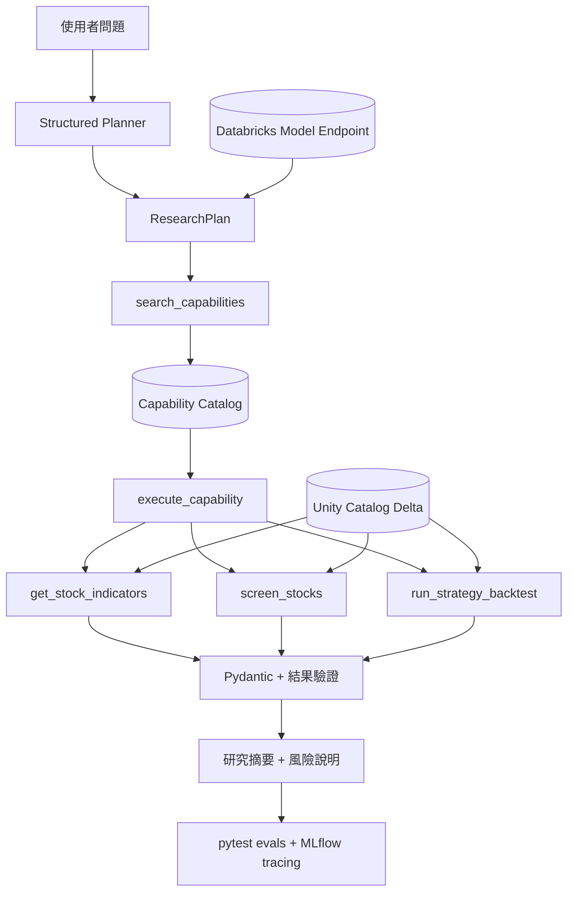

# FinLab 量化研究 Agent（教學型 MVP）

這個子專案實作一個「LLM 規劃問題、搜尋能力、Python 算數值、驗證層擋錯誤」的
研究 Agent。
模型、價格與因子資料放在 Databricks；本機 CSV 只用於開發與 pytest。

> 本專案僅供教學與研究，不構成投資建議，也不會代替使用者下單。

## 架構



關鍵界線：Planner 只拆解問題，不知道實作工具名稱；Executor 必須先搜尋 capability，
再使用短效 token 執行搜尋結果中的 allow-listed tool。Agent 不計算金融數值，也不執行
它產生的 Python。所有數值來自 `calculations.py`；所有 SQL 僅能查詢部署時指定的
Unity Catalog 表。

完整設計見 [Planner 與 Capability Catalog 架構](docs/planner-capability-architecture.md)。

## 三個工具

### 1. `get_stock_indicators`

- 輸入：`stock_id`、`as_of`
- 輸出：資料日期、收盤價、MA20、MA60、20 日價格動能
- 至少需要截止日前 60 個交易日

### 2. `screen_stocks`

- 輸入：允許的 `rules`、可選股票池、`sort_by`、`sort_order`、`as_of`
- 輸出：符合條件的股票與收盤價、均線、動能、成交量、營收年增率
- 規則採 AND；例如營收年增率大於 15% 且價格高於 MA60：

```json
{
  "rules": [
    {"field": "revenue_yoy", "operator": ">", "value": 0.15},
    {"field": "price_above_ma60", "operator": "==", "value": true}
  ],
  "stock_ids": ["2330", "2454", "0050"],
  "sort_by": "revenue_yoy",
  "sort_order": "desc",
  "as_of": "2024-05-20"
}
```

`revenue_yoy` 使用小數比例：15% 寫成 `0.15`。

### 3. `run_strategy_backtest`

- 輸入：`strategy_id`、`start_date`、`end_date`
- 輸出：累積／年化報酬、年化波動、最大回撤、Sharpe Ratio、交易數、
  週轉率、估計成本、權益曲線
- 策略只可來自 [`strategies.py`](src/finlab_agent/strategies.py) 的白名單：
  - `tw_ma20_60`
  - `tw_momentum_top2`

新增策略時要由開發者修改 `STRATEGY_CATALOG`、code review 並補測試；LLM 無權
更改股票池、視窗、成本或執行任意程式碼。

## 專案結構

```text
finlab_agent/
├── app.py                         # Streamlit 對話介面
├── app.yaml                       # Databricks Apps 啟動與資源映射
├── contracts/
│   ├── data_products.v1.json      # 可機器驗證的 Gold 契約 manifest
│   └── capabilities.v1.json       # 可搜尋、版本化的能力目錄
├── src/finlab_agent/
│   ├── agent.py                   # structured planner、executor、MLflow tracing
│   ├── capabilities.py            # 能力搜尋、短效 grant、安全 dispatch
│   ├── tools.py                   # 三個 @tool
│   ├── calculations.py            # 純 Pandas 確定性計算
│   ├── repository.py              # CSV / Databricks SQL adapters
│   ├── schemas.py                 # 輸入與輸出契約
│   ├── strategies.py              # 策略白名單
│   └── validation.py              # NaN 正規化與風險揭露檢查
├── tests/                         # 單元、契約、數值、風險、live routing eval
└── docs/                          # 架構、資料契約、部署與學習說明
```

## 本機快速開始

確定性測試可使用 Python 3.10–3.13；Databricks runtime／本機完整 App 建議使用
Python 3.10–3.12（`databricks-connect` 尚未支援 3.13）：

```powershell
cd finlab_agent
python -m venv .venv
.\.venv\Scripts\Activate.ps1
python -m pip install -r requirements-dev.txt
pytest
```

若只想看 App，不需要 Databricks endpoint 或 API key：

```powershell
$env:FINLAB_DATA_BACKEND = "sample"
$env:FINLAB_MODEL_BACKEND = "demo"
$env:PYTHONPATH = "src"
streamlit run app.py
```

左側 Demo 按鈕會執行真實 capability、Pandas 計算與驗證，只是不呼叫 LLM。

若要啟動完整對話 Agent，請使用 Python 3.10–3.12、另安裝 `requirements.txt`，並提供可呼叫
Databricks 模型端點的本機認證：

```powershell
$env:DATABRICKS_HOST = "https://<workspace-host>"
$env:DATABRICKS_TOKEN = "<local-development-token>"
$env:DATABRICKS_MODEL_ENDPOINT = "<endpoint-name>"
$env:FINLAB_DATA_BACKEND = "sample"
$env:FINLAB_MODEL_BACKEND = "databricks"
streamlit run app.py
```

不要提交 token；部署到 Databricks Apps 時使用 App service principal。

## 測試層級

```powershell
# 不連外：資料契約、MA、篩選、回測、前視偏誤、交易成本、風險文字
pytest

# 連到 Databricks 模型：確認真實 Agent 的規劃、能力發現與多步執行
$env:RUN_LIVE_AGENT_EVAL = "true"
pytest tests/test_tool_selection_live.py -q
```

完整資料契約見 [Agent 資料契約與 Tool 擴充規格](docs/data-contracts.md)，Gold tables
建立方式見 [Gold Data 部署指南](../docs/gold_data_deployment_zh-TW.md)，App 部署見
[Databricks 部署指南](docs/databricks-deployment.md)，逐步理解程式見
[學習指南](docs/learning-guide.md)，模型與無 LLM 預覽方式見
[模型選擇與 Demo](docs/model-providers-and-demo.md)。

## FinLab 對應關係

- FinLab `data.get('price:收盤價')` 的寬表概念，在 Gold 層正規化為
  `date + stock_id + OHLCV` 長表。
- FinLab 月營收年增率正規化為 `revenue_yoy`。
- FinLab `backtest.sim()` 的「持倉矩陣 → 績效」概念，在 MVP 以純 Pandas
  實作，方便在 Unity Catalog 資料上做確定性測試。若未來改用官方 FinLab
  engine，只需新增 calculation adapter，不需改 Agent。

