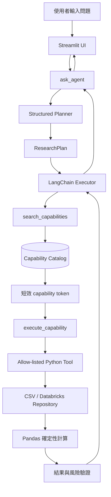

# 學習指南：從 UI 問題到可驗證答案

這份指南從初心者的角度，沿著一次使用者提問實際走過的路徑，解釋 FinLab 量化研究
Agent 的 UI、Structured Planner、ResearchPlan、Capability Search、資料存取、Pandas
計算與結果驗證。

文中的函式名稱都是連結。閱讀解釋時，可以直接點擊函式，例如
[`PlanningResearchAgent._plan()`](../src/finlab_agent/agent.py#L74-L98)，跳到實際程式碼。

> 若程式日後增刪行數，GitHub 的行號連結可能需要更新；相對檔案路徑仍可直接開啟原始碼。

## 整體心智模型

這個 Agent 可以想成五個角色：

1. **接待員 UI**：接收問題、保存對話、顯示答案。
2. **研究規劃員 Planner**：把問題拆成可驗證的研究步驟。
3. **能力目錄 Catalog**：找出系統現在允許執行的能力。
4. **受控計算工具**：讀資料並用固定 Python 程式計算金融數字。
5. **回答整理員 Executor**：根據工具證據整理答案與限制。



最重要的界線是：**LLM 不直接查資料庫、不直接寫 SQL，也不負責計算金融數字。**
LLM 負責規劃、選擇能力及整理答案；數值由固定、可測試的 Pandas 程式產生。

## 一次請求的完整生命週期

以「先查 2330 技術面，再回測 `tw_ma20_60`」為例：

1. 使用者在 [`app.py`](../app.py) 的 Streamlit UI 輸入問題。
2. UI 呼叫 [`ask_agent()`](../src/finlab_agent/service.py#L46-L74)，並附上最近 12 則對話。
3. [`PlanningResearchAgent._plan()`](../src/finlab_agent/agent.py#L74-L98) 要求模型輸出
   `ResearchPlan`，而不是直接回答。
4. Pydantic 使用 [`ResearchPlan`](../src/finlab_agent/schemas.py#L120-L140) 驗證計畫格式。
5. [`PlanningResearchAgent.invoke()`](../src/finlab_agent/agent.py#L100-L124) 把已驗證計畫交給
   Executor。
6. Executor 對技術指標步驟呼叫 `search_capabilities`。
7. Capability Catalog 找到 `market.indicators/v1`，並回傳 input schema 與短效 token。
8. Executor 使用相同 token 呼叫 `execute_capability`。
9. Gateway 驗證 token、capability scope 與參數，再執行 `get_stock_indicators`。
10. Repository 從 CSV 或 Databricks 讀取資料。
11. [`calculate_indicators()`](../src/finlab_agent/calculations.py#L24-L37) 用 Pandas 計算數值。
12. Executor 對回測步驟重新搜尋能力，取得另一個允許回測的 token。
13. [`run_backtest()`](../src/finlab_agent/calculations.py#L106-L190) 執行回測並產生風險指標。
14. [`validate_tool_result()`](../src/finlab_agent/validation.py#L33-L41) 驗證輸出與風險聲明。
15. Executor 只根據工具結果整理答案。
16. Service 抽出答案、使用過的 capability 和研究計畫，交回 UI 顯示。

## 從 UI 往後端逐層閱讀

### 1. Streamlit UI

Streamlit 的重要特性是：使用者按按鈕或送出訊息時，整支 Python script 會從上到下重新
執行。

[`get_runtime()`](../app.py#L26-L30) 讀取設定、建立 Repository 和 Agent。它使用
`@st.cache_resource`，所以 rerun 時不會一直重建這些昂貴物件。

[`app.py` 的 Session State](../app.py#L62-L76) 將對話保存在
`st.session_state.messages`。每筆 Assistant 訊息除了文字，也保存用過的 capabilities 和
ResearchPlan。實際送出問題與顯示結果的程式在
[`app.py` 第 78 至 113 行](../app.py#L78-L113)。

### 2. Service 轉接層

[`ChatResult`](../src/finlab_agent/service.py#L11-L17) 是 UI 最後收到的統一資料格式。
[`_content_to_text()`](../src/finlab_agent/service.py#L20-L31) 將不同模型文字格式轉成字串；
[`_tool_payload()`](../src/finlab_agent/service.py#L34-L43) 將 ToolMessage 的 dict 或 JSON 字串
統一成 dict。

[`ask_agent()`](../src/finlab_agent/service.py#L46-L74) 會限制對話歷史為最近 12 則、呼叫
`agent.invoke()`，再從 ToolMessage 收集 capability ID，並從最後一個 AIMessage 取得回答。

### 3. Structured Planner

[`PLANNER_PROMPT`](../src/finlab_agent/agent.py#L44-L54) 要求 Planner 只規劃、不計算、不回答，
而且每一步只能描述需要的能力，不可以猜工具名稱。

[`_latest_user_text()`](../src/finlab_agent/agent.py#L57-L63) 由後往前找最新使用者問題。
[`PlanningResearchAgent._plan()`](../src/finlab_agent/agent.py#L74-L98) 的核心概念是：

```python
planner = model.with_structured_output(ResearchPlan)
raw_plan = planner.invoke([SystemMessage(content=PLANNER_PROMPT), *messages])
plan = ResearchPlan.model_validate(raw_plan)
```

若 structured output 發生 exception，程式會改用單一步驟 fallback，並標記
`planning_mode="fallback"`。Capability discovery 與 execution 的安全流程仍然保留。

[`PlanningResearchAgent.invoke()`](../src/finlab_agent/agent.py#L100-L124) 會在需要澄清時直接
向使用者追問；否則把 ResearchPlan JSON 放進 SystemMessage，再交給 Executor。

目前 `depends_on` 是交由 Executor 根據 prompt 遵守，沒有 Python DAG scheduler 強制排序。
因此 ResearchPlan 是「結構化工作單」，還不是完全程式化的 workflow engine。

[`configure_tracing()`](../src/finlab_agent/agent.py#L127-L135) 啟用 Databricks MLflow tracing；
[`build_agent()`](../src/finlab_agent/agent.py#L138-L164) 則建立 Demo Agent 或完整 LLM Agent。

### 4. ResearchPlan

[`ResearchStep`](../src/finlab_agent/schemas.py#L104-L117) 定義單一步驟：

|欄位|用途|
|---|---|
|`step_id`|穩定步驟識別，例如 `step_1`|
|`question`|這一步要回答的子問題|
|`capability_query`|拿去搜尋能力目錄的自然語言|
|`required_inputs`|股票、日期、策略等必要參數|
|`depends_on`|必須先完成的步驟 ID|

[`ResearchPlan`](../src/finlab_agent/schemas.py#L120-L140) 再加入總目標、假設、是否需要澄清
以及澄清問題。[`check_clarification()`](../src/finlab_agent/schemas.py#L127-L140) 會檢查重複
step ID、未知依賴、自我依賴和缺少的澄清問題。目前尚未檢查多步驟循環依賴。

ResearchPlan 不是模型的隱藏思考過程，也不是金融答案；它是一份可以保存、顯示和測試的
結構化工作單。

### 5. Capability Search 與短效授權

能力目錄的 source of truth 是
[`capabilities.v1.json`](../contracts/capabilities.v1.json)。目前有三個能力：

|Capability ID|實作工具|功能|
|---|---|---|
|`market.indicators/v1`|`get_stock_indicators`|單一股票價格、MA20、MA60、20 日動能|
|`market.screen/v1`|`screen_stocks`|依允許條件篩選與排序股票|
|`strategy.backtest/v1`|`run_strategy_backtest`|執行白名單策略回測|

[`CapabilityDefinition.public_dict()`](../src/finlab_agent/capabilities.py#L38-L52) 將內部能力
轉成可公開給 Executor 的 metadata，input schema 直接從實作工具的 Pydantic schema 產生。

[`CapabilityRegistry.from_manifest()`](../src/finlab_agent/capabilities.py#L86-L116) 讀取 manifest，
再把 `implementation_tool` 綁到啟動時明確注入的 Python allow-list。Manifest 不能要求系統
動態 import 任意模組。

[`CapabilityRegistry._score()`](../src/finlab_agent/capabilities.py#L122-L142) 目前是文字與 tag
比對，不是 embedding、向量資料庫或網路搜尋。

[`CapabilityRegistry.search()`](../src/finlab_agent/capabilities.py#L144-L177) 會排序能力、產生
隨機 token，並記住這個 token 允許哪些 capability。預設期限為 900 秒；token 在期限內可
重複使用，不是一次性 token。

[`CapabilityRegistry.execute()`](../src/finlab_agent/capabilities.py#L179-L207) 依序檢查 token、
期限、capability scope、啟用狀態與 arguments，全部通過才執行 Python tool。

[`create_capability_gateway_tools()`](../src/finlab_agent/capabilities.py#L220-L243) 建立 Executor
唯一看得到的兩個入口：`search_capabilities` 和 `execute_capability`。

### 6. Tool、Repository、Calculation 與 Validation

[`create_finlab_tools()`](../src/finlab_agent/tools.py#L22-L159) 建立三個真正金融工具：

- [`get_stock_indicators()`](../src/finlab_agent/tools.py#L23-L55)：單一股票指標。
- [`screen_stocks_tool()`](../src/finlab_agent/tools.py#L57-L102)：多條件選股。
- [`run_strategy_backtest_tool()`](../src/finlab_agent/tools.py#L104-L157)：白名單策略回測。

工具不直接拼接任意查詢。它們先通過 schema，再呼叫
[`PriceRepository`](../src/finlab_agent/repository.py#L18-L32) 的固定介面。
[`build_repository()`](../src/finlab_agent/repository.py#L208-L219) 根據設定選擇 CSV 或
Databricks 實作。

真正數值由 [`calculate_indicators()`](../src/finlab_agent/calculations.py#L24-L37)、
[`screen_stocks()`](../src/finlab_agent/calculations.py#L49-L86) 和
[`run_backtest()`](../src/finlab_agent/calculations.py#L106-L190) 產生，不由 LLM 估算。

最後 [`to_builtin()`](../src/finlab_agent/validation.py#L16-L30) 將 NumPy、日期和 NaN 轉為
JSON-friendly 型別；[`validate_tool_result()`](../src/finlab_agent/validation.py#L33-L41)
驗證輸出結構，並強制回測結果包含投資建議、前視偏誤、交易成本和存活者偏誤說明。

## 核心函式索引

### UI、Service 與 Agent

|函式|用途|
|---|---|
|[`get_runtime()`](../app.py#L26-L30)|建立並快取設定、Repository 和 Agent|
|[`_content_to_text()`](../src/finlab_agent/service.py#L20-L31)|將不同模型 content 格式統一成文字|
|[`_tool_payload()`](../src/finlab_agent/service.py#L34-L43)|將 ToolMessage payload 解析成 dict|
|[`ask_agent()`](../src/finlab_agent/service.py#L46-L74)|整理歷史、呼叫 Agent 並收集回答與 capabilities|
|[`_latest_user_text()`](../src/finlab_agent/agent.py#L57-L63)|尋找最新使用者問題|
|[`PlanningResearchAgent._plan()`](../src/finlab_agent/agent.py#L74-L98)|要求模型輸出 ResearchPlan，失敗時使用安全 fallback|
|[`PlanningResearchAgent.invoke()`](../src/finlab_agent/agent.py#L100-L124)|處理澄清或把計畫交給 Executor|
|[`configure_tracing()`](../src/finlab_agent/agent.py#L127-L135)|設定 MLflow tracking 與 LangChain autolog|
|[`build_agent()`](../src/finlab_agent/agent.py#L138-L164)|建立 Demo Agent 或 Planner + Executor runtime|

### Capability Registry

|函式|用途|
|---|---|
|[`CapabilityDefinition.public_dict()`](../src/finlab_agent/capabilities.py#L38-L52)|輸出安全 metadata 與真正 input schema|
|[`CapabilityRegistry.__init__()`](../src/finlab_agent/capabilities.py#L69-L84)|保存啟用能力、TTL、grant 和 thread lock|
|[`CapabilityRegistry.from_manifest()`](../src/finlab_agent/capabilities.py#L86-L116)|讀 manifest 並綁定 allow-listed Python tools|
|[`CapabilityRegistry.capability_ids`](../src/finlab_agent/capabilities.py#L118-L120)|列出啟用中的 capability IDs|
|[`CapabilityRegistry._score()`](../src/finlab_agent/capabilities.py#L122-L142)|用 tag 與文字包含關係計算搜尋分數|
|[`CapabilityRegistry.search()`](../src/finlab_agent/capabilities.py#L144-L177)|搜尋能力並產生有 scope 的短效 token|
|[`CapabilityRegistry.execute()`](../src/finlab_agent/capabilities.py#L179-L207)|驗證 token、scope 與參數後 dispatch 工具|
|[`build_capability_registry()`](../src/finlab_agent/capabilities.py#L210-L217)|組合 capability manifest 與 Python tool allow-list|
|[`create_capability_gateway_tools()`](../src/finlab_agent/capabilities.py#L220-L243)|建立 search / execute 兩個 LangChain gateway tools|
|[`search_capabilities()`](../src/finlab_agent/capabilities.py#L221-L228)|讓 Executor 用自然語言搜尋能力|
|[`execute_capability()`](../src/finlab_agent/capabilities.py#L230-L241)|讓 Executor 執行同次搜尋授權的能力|

### Schema 與 Validator

|Schema / function|用途|
|---|---|
|[`GetIndicatorsInput`](../src/finlab_agent/schemas.py#L10-L20)|股票代號與指標截止日|
|[`clean_stock_id()`](../src/finlab_agent/schemas.py#L14-L20)|去空白、轉大寫並限制股票代號長度|
|[`ScreenRule`](../src/finlab_agent/schemas.py#L23-L34)|限制可篩選欄位與比較 operator|
|[`ScreenStocksInput`](../src/finlab_agent/schemas.py#L37-L49)|限制規則數、股票數、排序方式與輸出筆數|
|[`RunStrategyBacktestInput`](../src/finlab_agent/schemas.py#L57-L66)|限制策略 ID 與回測日期|
|[`check_dates()`](../src/finlab_agent/schemas.py#L62-L66)|要求開始日早於結束日|
|[`ToolEnvelope`](../src/finlab_agent/schemas.py#L69-L75)|統一工具輸出 envelope|
|[`CapabilitySearchInput`](../src/finlab_agent/schemas.py#L78-L84)|限制 capability query 與結果數|
|[`CapabilityExecuteInput`](../src/finlab_agent/schemas.py#L87-L101)|驗證 token、capability ID 與 arguments|
|[`ResearchStep`](../src/finlab_agent/schemas.py#L104-L117)|定義單一研究步驟|
|[`ResearchPlan`](../src/finlab_agent/schemas.py#L120-L140)|定義完整結構化研究計畫|
|[`check_clarification()`](../src/finlab_agent/schemas.py#L127-L140)|驗證 step ID、依賴與澄清欄位|

### 設定與 Repository

|函式|用途|
|---|---|
|[`Settings.from_env()`](../src/finlab_agent/config.py#L28-L57)|讀取 backend、Warehouse、資料表、模型與 tracing 設定|
|[`Settings.validate()`](../src/finlab_agent/config.py#L59-L67)|檢查 backend、Warehouse 和列數上限|
|[`normalize_prices()`](../src/finlab_agent/repository.py#L35-L53)|驗證並正規化 OHLCV|
|[`normalize_factors()`](../src/finlab_agent/repository.py#L56-L66)|驗證並正規化營收因子|
|[`CsvPriceRepository.__init__()`](../src/finlab_agent/repository.py#L72-L74)|保存 CSV 路徑|
|[`CsvPriceRepository.load_prices()`](../src/finlab_agent/repository.py#L76-L90)|讀取並篩選 CSV 價格|
|[`CsvPriceRepository.load_factors()`](../src/finlab_agent/repository.py#L92-L103)|讀取並篩選 CSV 因子|
|[`DatabricksSqlPriceRepository.__init__()`](../src/finlab_agent/repository.py#L111-L125)|驗證表名並保存連線設定|
|[`DatabricksSqlPriceRepository._connect()`](../src/finlab_agent/repository.py#L127-L138)|使用 Databricks SDK 認證連線|
|[`DatabricksSqlPriceRepository.load_prices()`](../src/finlab_agent/repository.py#L140-L175)|以參數化 SQL 載入價格|
|[`DatabricksSqlPriceRepository.load_factors()`](../src/finlab_agent/repository.py#L177-L205)|以參數化 SQL 載入因子|

### 計算與策略

|函式|用途|
|---|---|
|[`_rsi()`](../src/finlab_agent/calculations.py#L13-L21)|計算 RSI；目前尚未接到公開 capability|
|[`calculate_indicators()`](../src/finlab_agent/calculations.py#L24-L37)|計算收盤價、MA20、MA60、20 日動能|
|[`screen_stocks()`](../src/finlab_agent/calculations.py#L49-L86)|計算最新指標並套用 AND 篩選規則|
|[`_rebalance_targets()`](../src/finlab_agent/calculations.py#L96-L103)|依日或 period frequency 更新目標權重|
|[`run_backtest()`](../src/finlab_agent/calculations.py#L106-L190)|產生訊號、延遲持倉、扣成本並計算績效|
|[`get_strategy()`](../src/finlab_agent/strategies.py#L41-L45)|只從版本控制的策略白名單取設定|

### Tool 與結果處理

|函式|用途|
|---|---|
|[`_records()`](../src/finlab_agent/tools.py#L15-L19)|將 DataFrame 轉成 JSON records|
|[`create_finlab_tools()`](../src/finlab_agent/tools.py#L22-L159)|建立三個 LangChain 金融工具|
|[`to_builtin()`](../src/finlab_agent/validation.py#L16-L30)|將日期與 NumPy 型別轉成標準 Python 型別|
|[`validate_tool_result()`](../src/finlab_agent/validation.py#L33-L41)|驗證 ToolEnvelope 與回測風險文字|

### Demo 模式

|函式|用途|
|---|---|
|[`_latest_question()`](../src/finlab_agent/demo.py#L20-L26)|取得最新使用者問題|
|[`_pretty_percent()`](../src/finlab_agent/demo.py#L29-L30)|將小數格式化為百分比|
|[`DemoResearchAgent._run_capability()`](../src/finlab_agent/demo.py#L39-L50)|在 Demo 中仍先搜尋再執行能力|
|[`DemoResearchAgent.invoke()`](../src/finlab_agent/demo.py#L52-L216)|用 regex 與關鍵字建立計畫並執行工具|

Demo 不是完整自然語言理解。例如問題包含「營收」時，Demo 固定使用
`revenue_yoy > 0.15`，不會可靠解析任意營收門檻。

## 真正的安全邊界

Prompt 是行為指示，不是唯一安全機制。真正的邊界是：

```text
Capability manifest
+ 啟動時注入的 Python allow-list
+ 短效 discovery grant
+ Capability token scope
+ Pydantic input schema
+ 策略白名單
+ 固定 Repository query
+ Databricks 最小權限
+ 結果與風險驗證
```

因此模型不能合法地跳過搜尋、任意執行 Python、傳入任意 SQL/表名，或使用不存在於白名單
的 strategy ID。

## 建議的動手學習順序

建議按以下順序閱讀與動手修改。

## 第 1 關：不用 LLM，先相信計算

閱讀 [`calculations.py`](../src/finlab_agent/calculations.py) 與
[`test_calculations.py`](../tests/test_calculations.py)。先執行 `pytest`，再故意拿掉
`targets.shift(1)`；
[`test_signal_is_shifted_one_day_to_avoid_lookahead`](../tests/test_calculations.py#L63-L88)
應失敗。這能直接看到
「訊號形成時間」為什麼比 prompt 寫得漂亮更重要。

## 第 2 關：理解資料邊界

閱讀 [`repository.py`](../src/finlab_agent/repository.py) 與
[`test_repository.py`](../tests/test_repository.py)。CSV 與 Databricks adapter 都回傳相同 schema，所以計算不必知道
資料放在哪裡。請嘗試在 fixture 加重複 `date + stock_id`，測試應拒絕它。

## 第 3 關：理解工具契約

閱讀 [`schemas.py`](../src/finlab_agent/schemas.py)、
[`tools.py`](../src/finlab_agent/tools.py) 與
[`test_tools_and_risk.py`](../tests/test_tools_and_risk.py)。Pydantic 限制可用欄位、運算子、日期與策略 ID；工具只
把驗證過的參數交給計算層。請嘗試傳入 `strategy_id="請執行這段 Python"`，輸入驗證應
直接拒絕。

## 第 4 關：理解能力目錄

閱讀 [`capabilities.v1.json`](../contracts/capabilities.v1.json) 與
[`capabilities.py`](../src/finlab_agent/capabilities.py)。模型只看得到
`search_capabilities` 和 `execute_capability`；實際金融 tools 留在 registry 後方。
先執行 [`test_capabilities.py`](../tests/test_capabilities.py)，再嘗試用「回測」搜尋取得的 token 執行指標能力，
應被 scope 檢查拒絕。

這一層的重點是：可發現不等於可任意執行。Manifest、Python allow-list、Pydantic schema
與 Unity Catalog 權限必須同時通過。

## 第 5 關：理解 Planner 與 Agent

閱讀 [`agent.py`](../src/finlab_agent/agent.py) 與
[`test_planning_runtime.py`](../tests/test_planning_runtime.py)。第一個模型呼叫產生 `ResearchPlan`，
第二階段 `create_agent` 才反覆執行「搜尋能力 → 執行能力 → 整合」。若 structured output
不可用，程式會標示 fallback，而不是讓模型自由產生程式。

系統提示詞不是安全邊界；真正的安全邊界是 discovery grant、工具 schema、策略白名單、
資料權限與沒有任意執行入口。

## 第 6 關：做 Evals

Evals 分四層：

1. **確定性單元測試**：MA、篩選、成本、回撤、前視偏誤。
2. **契約測試**：Gold、capability、工具輸出、來源資訊與必要風險文字。
3. **Planner／gateway 測試**：計畫格式、fallback、澄清、搜尋排名與 token scope。
4. **live agent eval**：使用實際 Databricks 模型，確認多步驟問題會規劃、搜尋並執行
   預期 capabilities。

新增功能時先加固定案例，再改 prompt 或工具。否則模型版本一換，你無法判斷行為是否
退步。

## 練習題

1. 新增 `revenue_yoy` 缺值時的警告，並寫測試。
2. 在策略白名單新增「60 日動能第一名」策略，不更動 public tool schema。
3. 新增 benchmark 報酬並測試 active return。
4. 把歷史股票池做成 `date + stock_id + is_member`，消除目前股票池造成的存活者偏誤。
5. 新增模型預測工具，但強制輸出 UC model version、feature timestamp 與模型限制。
6. 新增一個 capability 到 manifest 與 allow-list，確認完全不修改 Agent prompt 也能被搜尋。
7. 為 `ResearchPlan` 加入多步驟循環依賴檢查。
8. 把 `depends_on` 從 prompt 約束升級成由 Python workflow scheduler 強制執行。
9. 將 `CapabilityRegistry._score()` 改成可測試的中文斷詞或 embedding search，並保留安全
   fallback。

