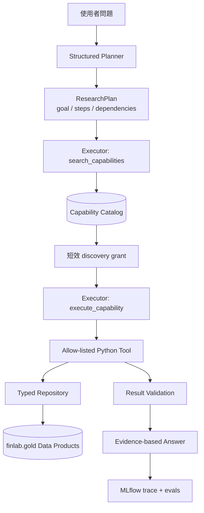
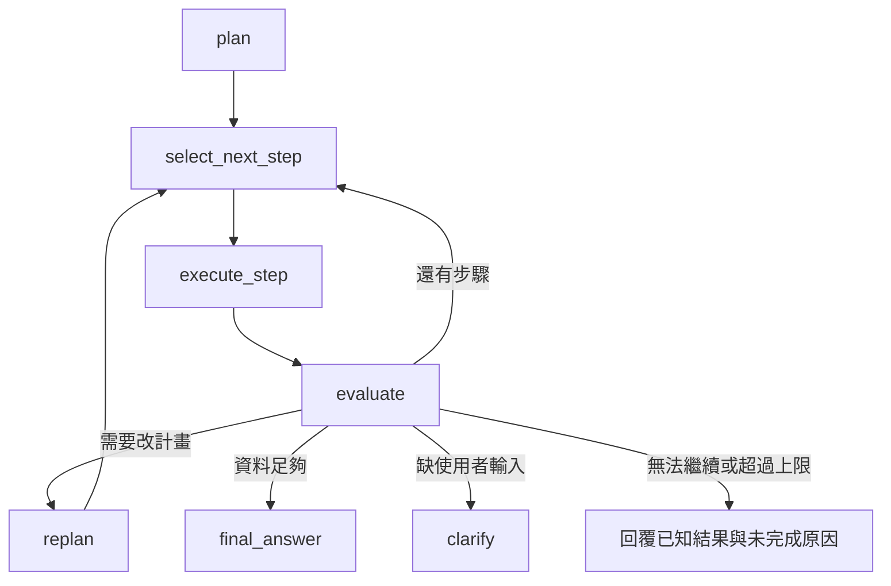
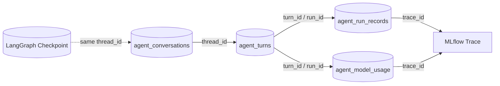

# Agent 與 finlab.gold 擴充實作指南

更新：2026-10-24。以下是待實作指南；標為「新增」的檔案與函式尚未存在。

**三條工作線：Agent runtime 按第 1～6 步擴充；Gold 按 G0～G3 擴充；工具自由度按 F1～F4 擴充。新增研究能力若需要新資料，必須先完成對應 Gold，再接 repository → calculation → tool → capability。只想先看到現有工具過程，做到第 1 步即可。**

本文件列「改什麼、在哪改、先後依賴」；Databricks 操作與驗收 SQL 使用 [Gold 部署指南](../../docs/gold_data_deployment_zh-TW.md)，完整資料欄位放 [data-contracts.md](data-contracts.md)，避免三處重複維護。

## 目前程式與修改順序

### 目前 Agent 架構圖

這張圖呈現現在已實作的 Planner、Capability Gateway、確定性工具與 Gold 資料流。Planner 目前只在每次請求開始時執行一次；圖中的 Executor 由 LangChain `create_agent()` 建立。



目前這張圖的控制邊界是：Planner 產生 ResearchPlan 後，Executor 可以根據 tool output 決定下一個 tool call，但不會回到 Planner 修改 ResearchPlan。第 3、4 步會把 Planner、Evaluator 與 Replanner 納入外層 LangGraph。

```text
app.py：接收問題、顯示回答
  → service.py / ask_agent()：準備 history，呼叫 agent
    → agent.py / PlanningResearchAgent.invoke()
      → _plan()：產生一次 ResearchPlan
      → executor.invoke()：Model ↔ Tools 循環，回傳 messages
    ← 加上 research_plan、planning_mode
  ← ChatResult：只留下回答、工具名稱、能力 ID、plan
```

executor 由 LangChain `create_agent()` 建立，底層已是 LangGraph。目前工具參數與結果留在 final messages，但 service 沒有交給 UI；Planner 也不會根據結果重寫計畫。

|順序|要得到的功能|主要修改位置|
|---|---|---|
|1|執行後查看每次 tool call|[service.py](../src/finlab_agent/service.py)、[app.py](../app.py)，新增 observability.py|
|2|每次模型呼叫的 tokens、cost、logging|[agent.py](../src/finlab_agent/agent.py)、observability.py|
|3|外層 LangGraph、即時進度|新增 graph_state.py、research_graph.py；修改 agent/service/app|
|4|根據工具結果 replan|新增 replanning.py；修改 graph、[schemas.py](../src/finlab_agent/schemas.py)|
|5|錯誤重試、執行上限|graph、[capabilities.py](../src/finlab_agent/capabilities.py)、[config.py](../src/finlab_agent/config.py)|
|6|歷史 Q&A、恢復執行|新增 history.py、persistence.py；修改 service/app|

表中的新增 Python 檔案統一放在 `src/finlab_agent/`。既有檔案可點連結閱讀。

### 整體先後依賴

```text
G0 驗收現有 Gold ───────────→ 現有三個工具可用
  ├─ Agent 1 → 2 → 3 → 4 → 5 → 6（執行流程與可觀測性）
  ├─ F1 單股指標參數化 → F2 有界通用選股
  └─ G1 身分／歷史股票池 → G2＋F3 全市場通用篩選 → G3／F4 新領域與受控策略
       每個資料產品：Gold 驗收 → repository → tool → capability 啟用
```

Agent 1～6 與 F1 可沿用目前資料或 fixtures 開發；名稱／產業解析依賴 G1，全市場高頻通用篩選依賴 G2，預測等能力依賴 G3。Replanner 只能改用已上線能力，不能補出尚未建置的資料。

## Gold 修改藍圖：G0～G3

下列「現有」指 repo 已有契約／producer，不代表已確認你的 Databricks 正式表部署完成；G1～G3 全部是待建。新表名預設在 `finlab.gold`，新增 notebook 放 `databricks_migrate/notebooks/`。

### G0：先驗收現有資料，固定後續擴充基準

|現有產品|產製／消費位置|先確認什麼|
|---|---|---|
|daily_prices/v2|[materialize_agent_gold.py](../../databricks_migrate/notebooks/materialize_agent_gold.py) → repository.load_prices()|date＋完整 stock_id 唯一；OHLC、adjustment_basis、freshness 通過；00679B 不可改用純數字當 key|
|stock_factors/v1|同一 notebook → repository.load_factors()|date = available_at；不可早於 source_release_date；營收 warm-up null 不用未來值補|
|data_contract_registry/v1|同一 notebook 的 registry_rows／MERGE 區塊|版本與 manifest、table properties 一致；不要只憑 active 字串判斷資料品質|
|forecast_training_features/v1|[forecast_training_features.py](../../databricks_migrate/notebooks/forecast_training_features.py)|僅供 training；含未來 return/rank labels，不能當 Agent 的 forecast 來源|

照部署指南第 5～7 節先跑 candidate，再跑正式 full。daily_prices v1 → v2 要 full rebuild；日常價格更新使用 14 日 lookback incremental，舊 corporate-action revision 超過 lookback 時另做 full。stock_factors 目前仍全量重算。

**完成條件：** 部署指南第 6 節 SQL 通過；三個現有工具的數值與直接 SQL/Pandas 抽樣一致。先記下表版本與 Job run ID，作為後續回歸基準。

### G1：先補證券身分與歷史股票池

|新增產品／用途|必要資料與時間語意|新增 producer 與 Agent 接點|
|---|---|---|
|security_master/v1：名稱、產業、交易所、上市狀態解析|stock_id、name、exchange、industry、security_type、valid_from/to、available_at；名稱／分類保留有效期間|新增 materialize_security_master.py；repository.py 新增 SecurityRepository.resolve_security(query, as_of)；tools.py 新增 resolve_security 工具|
|universe_membership/v1：查某日股票池、支援歷史回測|universe_id、stock_id、valid_from/to、available_at、source；區間不重疊，保留加入／退出與下市成員|新增 materialize_universe_membership.py；repository.py 新增 UniverseRepository.load_members(universe_id, as_of)；回測另加 load_membership_history(start, end)|

**先補來源再建表：** 目前價格只能提供部分身分線索，不能推定完整上市／下市與歷史成分。確認權威歷史來源、覆蓋期間與公告時間；若缺 Bronze，先改 [crawler_registry.py](../../databricks_migrate/databricks_src/crawler_registry.py) 登錄 DatasetSpec，並在 [crawler.py](../../finlab/crawler.py) 加對應抓取函式。只有現在成分的來源只能提供現在查詢，不可宣稱已解決歷史偏誤。

接回測時，修改 [strategies.py](../src/finlab_agent/strategies.py) 的股票池設定，以及 [calculations.py](../src/finlab_agent/calculations.py) 的 run_backtest()：每個 rebalance date 取當時可知成員，不能把今天的股票池套完整段歷史。仍需處理下市價格、停牌與缺價；光新增 membership 表不等於消除全部存活者偏誤。

**完成條件：** 名稱變更、ETF 字尾、成員加入／退出與下市案例測試通過；同一過去日期不受未來分類或成分變更影響。

### G2：支援大股票池技術／基本面篩選

|新增產品／用途|必要契約|新增 producer 與 Agent 接點|
|---|---|---|
|market_features_daily/v1：預計算技術特徵|date、stock_id、MA／動能／波動／流動性、adjustment_basis、calculation_version、available_at|新增 materialize_market_features_daily.py，依賴 daily_prices；repository.py 新增 MarketFeatureRepository.screen_features()；tools.py 篩選路徑採固定欄位查詢|
|fundamentals_point_in_time/v1：通用財務 metric 篩選|stock_id、metric_id、period_end、available_at、revision_id、value、unit、source（long format）|新增 materialize_fundamentals_pit.py；repository.py 新增 FundamentalRepository.load_metrics(metric_ids, as_of)；schemas.py 擴充核准 metric/operator，tools.py 組合篩選|

預計算技術特徵須有 rolling warm-up，lookback 不可直接照抄價格的 14 天；價格修訂時重算受影響特徵區間。與現有 calculate_indicators()／screen_stocks() 做相同 adjustment、缺值與窗口的 parity test。

基本面第一批可由營收資料起步，其他財報 metric 先補來源。查詢先限制 available_at ≤ as_of，再選當時可見 revision；目前 stock_factors 的同 key 覆寫與 Delta history，不能直接當成完整的歷史公告版本庫。舊 revisions 不足時須明確限制可用回測期間。

**完成條件：** Spark 預計算與 Pandas 抽樣一致；資料修訂、warm-up、未公告財報不可見的測試通過；全市場篩選在固定 row/date limits 內完成。

### G3：按研究需求加入籌碼、預測與事件

|新增產品|producer／來源工作|Agent 接點與必要驗收|
|---|---|---|
|institutional_flows_daily/v1|新增 materialize_institutional_flows.py；先核對 Bronze bargin_report 的法人分類、買賣／淨額與單位；補 available_at|新增 FlowRepository.load_flows()＋籌碼工具；同分類同日期 key 唯一、單位一致、公告前不可見|
|model_forecasts/v1|新增 materialize_model_forecasts.py；由核准模型做推論，保留 stock_id、model_version、feature_as_of、prediction_at、available_at、horizon、prediction|新增 ForecastRepository.load_forecasts()＋get_model_forecast 工具；feature_as_of 不晚於 prediction_at，查詢時預測已發布；不得讀 training labels|
|corporate_events/v1|新增 materialize_corporate_events.py；補 event_id、event_type、event_date、announced_at、available_at、revision；現有調整 ratios 不等於完整事件歷史|新增 EventRepository.load_events()＋事件工具；已公告未來事件可以查，尚未公告事件不可用於歷史決策|

Forecast training/tuning 沿用部署指南第 8、9.2 節及 [模型流程指南](../../docs/forecast_feature_and_tuning_automation_zh-TW.md)，另接「核准模型推論 → model_forecasts」。每日資料刷新不自動觸發昂貴 tuning。每項 G3 能力獨立驗收、獨立啟用。

### 每個新 Gold 產品都照這張修改表交付

|順序|改哪個檔案／位置|交付內容|
|---|---|---|
|1. 契約|[data-contracts.md](data-contracts.md)＋[data_products.v1.json](../contracts/data_products.v1.json)|key、欄位／單位、available-time、revision、freshness、版本、consumer；待部署產品不先標 active|
|2. Producer|上述新增 materialize_*.py|正規化、quality gates、candidate/full/incremental、table properties、registry 登錄；缺來源先補 Bronze|
|3. 共用寫入|materialize_agent_gold.py 的 write_contract_table()、registry_rows 區塊|抽成新增 databricks_src/gold_contracts.py 的可重用寫入／登錄 helper；各 producer 呼叫，避免每張表複製硬編碼登錄|
|4. 查詢與工具|repository.py、schemas.py、tools.py、必要的 calculations.py|typed repository、固定參數化查詢、as_of、row/date limits、provenance；補 CSV/fake adapter 供本機測試|
|5. 能力登錄|[capabilities.v1.json](../contracts/capabilities.v1.json)＋capabilities.py 的 build_capability_registry()|tool 加入 allow-list，宣告 required_data_products；部署 gate 通過後才 enabled|
|6. App 設定|config.py、.env.example、[app.yaml](../app.yaml)＋Databricks App resources|新表設定與 resource key 一致；App 只讀核准 consumer tables，producer Job 才有寫 Gold 權限|
|7. 部署與驗收|[Gold 部署指南](../../docs/gold_data_deployment_zh-TW.md) 的第 5～7、9～13 節|candidate → 品質／契約測試 → 正式表 → 綁 App → canary 問答；保留相容舊表與可回復版本|

**啟用檢查需新增實作：** 建議新增 finlab_agent/scripts/check_capability_readiness.py，驗證 manifest、tool 存在、required contracts active、table properties 版本、quality/freshness 與實際 App 讀取權限。現有 registry.search() 不會自動驗證所有 Gold 部署狀態；部署未完成的能力不要讓 Planner 搜尋到。

可選的 `finlab.gold.agent_capability_registry` 只是 Git manifest 的稽核投影，記 input schema、依賴版本與 deployed_commit；不取代 Python allow-list 或授權。等部署檢查完成後再做，不是 G1 的前置。

### 排程、測試與完成順序

- **排程：** crawler 成功 → G0 → 對應衍生產品；security/universe 隨來源更新，技術特徵按交易日、財報按公告、預測按核准模型批次。current [databricks.yml](../../databricks_migrate/databricks.yml) 只有 bundle/target，尚無 Job 定義；可先依部署指南建 Job，後續在該檔 include 新增 resources/gold_jobs.yml 管理 tasks/dependencies，避免同時留兩份有效排程。
- **測試：** 每個 producer 新增 databricks_migrate/tests/test_gold_<product>.py 測可抽離邏輯；Spark/Delta candidate 驗收在 Databricks serverless 跑。本機不可直接執行依賴 spark/dbutils 的 notebook。Agent 端補 test_data_contract_manifest.py、test_repository.py、test_capabilities.py 與 routing cases。
- **先完成：** G0＋Agent 1/2 → G1＋對應 tools → Agent 3～6 與 G2 → 依實際問題選 G3。Gold 缺資料時回覆能力缺口；不可讓 retry/replan 掩蓋資料未部署。

Agent 第 6 步的 Q&A／events 是應用紀錄，建議另放 `finlab.control` 或專用 history backend；不要為保存對話而給 App 整個 `finlab.gold` 的寫入權限。

## 工具自由化藍圖：F1～F4

目前工具是固定契約：`GetIndicatorsInput` 只有股票與日期，`calculate_indicators()` 固定算 MA20、MA60、20 日動能；`ScreenRule.field`、`sort_by` 也是固定欄位；回測只接受兩個 `strategy_id`。因此 MA10 不一定讓整個 Agent crash，但目前無法正確回答：額外參數可能被驗證拒絕或丟棄，最後應回報「能力不支援」。

自由化仍保留 schema、範圍與計算白名單；不接受任意 Python、SQL、欄位字串或模型自行發明公式。

|階段|完成後可回答|Gold 依賴|主要改動|
|---|---|---|---|
|F1：參數化單股指標|「2330 的 MA10／MA20／60 日報酬？」|G0 daily_prices 即可|IndicatorSpec、通用計算、indicators/v2|
|F2：有界通用選股|「價格高於 MA10 且 20 日報酬 > 5%」；限定股票數、規則數與期間|G0 即時計算；基本面先用 stock_factors 已有 metric|MetricSpec、ScreenRuleV2、screen/v2|
|F3：擴大全市場與複合研究|高頻全市場多條件篩選、名稱／產業／歷史股票池|G1 security/universe＋G2 features/fundamentals|預計算與 repository 自動選路徑|
|F4：受控策略與新領域|自訂均線窗口的白名單策略、籌碼／預測／事件組合研究|G1 universe；新領域依 G2/G3|StrategySpec、結果 provenance、新 capability|

每階段發布新 capability 版本，先保留 v1；完成 contract、routing 與回答 eval 後，才把 v2 設為主要搜尋結果。不需要一次完成 F1～F4。

### F1：先支援 MA10 等單股指標，不新增 Gold

|修改位置|具體修改|
|---|---|
|[schemas.py](../src/finlab_agent/schemas.py)|新增 `IndicatorSpec(kind, window)` 與 `GetIndicatorsV2Input`；kind 先限 `sma / return / avg_volume / volatility / rsi`，window 建議 2～252，一次最多 8 個|
|[calculations.py](../src/finlab_agent/calculations.py)|新增 `calculate_requested_indicators(prices, specs)`；以 `(kind, window)` 產生結果，禁止用字串找任意函式|
|[tools.py](../src/finlab_agent/tools.py)|新增 `get_market_indicators`；依最大 window 決定 warm-up，回傳通用 records、calculation version、實際資料區間與不足警告|
|[capabilities.v1.json](../contracts/capabilities.v1.json)|新增 `market.indicators/v2`，依賴 `daily_prices/v2`；保留 v1 供既有測試與 caller 使用|
|tests|參數化測 MA10／MA60、重複 window 去重、越界拒絕、歷史不足、截止日不前視，以及 v1 結果不變|

建議輸入：

```json
{
  "stock_id": "2330",
  "as_of": "2024-05-20",
  "indicators": [
    {"kind": "sma", "window": 10},
    {"kind": "sma", "window": 20},
    {"kind": "return", "window": 60}
  ]
}
```

輸出用陣列或以穩定 key 表示 `kind + window + value`，不要持續新增 `ma10`、`ma20`、`ma60` 欄位。Planner 只描述需求；Executor 依 capability input schema 填入 specs。

**先做到這裡就能回答 MA10。** 單一股票從 daily_prices 即時計算即可，不必等待 market_features_daily。

### F2：把選股條件改成有界、可組合規則

|修改位置|具體修改|
|---|---|
|schemas.py|新增 `MetricSpec(kind, window, metric_id)`、`ScreenRuleV2(metric, operator, value)`；技術 metric 使用 kind/window，基本面使用已登錄 metric_id|
|schemas.py|將排序也改成 MetricSpec，不再使用任意 `sort_by` 字串；先只支援所有規則 AND，一次最多 8 條、結果最多 100 筆|
|calculations.py|新增 `screen_by_rules()`；先批次計算每個唯一 metric spec，再套比較與排序，避免每條規則重算 rolling window|
|repository.py／tools.py|限定 stock_ids、as_of 與最大 lookback；未提供股票池時先套 server-side universe／row limit，不把整張 daily_prices 拉回 App|
|capability manifest|新增 `market.screen/v2`；搜尋描述列出支援的 metric kinds、operators、限制與輸出|

例如 `sma(window=10)`、`return(window=20)` 是合法結構；`field="任意 SQL"`、`formula="close / x"` 不合法。若之後需要 OR／巢狀條件，再新增受控的 `all`／`any` expression tree 與 depth/node 上限，不接收 SQL expression。

F2 可先服務小股票池或有限 universe；若全市場掃描超過 query/latency budget，明確回報需縮小範圍，進入 F3 後再擴大。

### F3：用 G1／G2 擴大查詢，不改使用者契約

F1/F2 的 input/output schema 保持不變，repository 根據需求選資料路徑：

```text
單股、少量股票、少見 window → daily_prices 即時計算
全市場、常用 window、頻繁查詢 → market_features_daily 預計算
名稱／產業／歷史股票池          → security_master + universe_membership
point-in-time 財務 metric       → fundamentals_point_in_time
```

G2 的 market_features_daily 第一版預算常用 window，例如 5、10、20、60、120、240；未預算 window 仍可在有界範圍即時計算。repository 決定路徑，不讓模型選 table。兩條路必須共用 calculation version，並用相同股票／日期做 parity test；結果 provenance 記錄 `on_demand` 或 `precomputed`。

**完成條件：** 同一查詢走兩條路得到等價結果；全市場查詢符合 timeout/row budget；過去 as_of 使用當時可見的 security/universe/fundamental 資料。

### F4：最後才開放受控策略參數與新研究領域

保留現有固定 strategy IDs，再新增版本化 `StrategySpec`，例如：

```text
template_id = sma_cross
fast_window = 10
slow_window = 60
universe_id = tw_equity
rebalance_frequency = monthly
```

限制 fast < slow、window／top_n／交易頻率範圍；交易成本與滑價採伺服器政策或有界參數。策略仍由 allow-listed template 執行，不能傳 Python。每次回測輸出完整 normalized config、config hash、universe contract/version、資料範圍、成本、calculation version 與 warnings，才能重現。

歷史全市場策略先完成 G1 universe_membership；否則只允許明確提供且揭露偏誤的固定股票清單。籌碼、forecast、event 等工具只接受 G3 已登錄欄位與版本。跨領域組合由 Planner 拆成多個 capabilities，最後基於 observations 回答，不建立一個接受任意查詢的萬能工具。

### 每一階段的上線順序

```text
schema 與限制
→ calculation unit tests
→ repository 查詢與 point-in-time tests
→ tool output/provenance validation
→ capability v2 登錄但 disabled
→ discovery/routing/safety eval
→ candidate Gold（若需要）與 App 權限
→ canary 問答
→ enabled=true；觀察後才淘汰 v1
```

當使用者要求尚未支援的 window、metric、strategy 或資料時，Tool／Evaluator 應回傳結構化 `unsupported_capability` 或 `unsupported_parameter`，讓 Planner 可以改用已上線能力或清楚說明缺口；不要讓它變成未分類 exception，也不要假裝算出答案。

## 1. 讓 UI 看得到工具過程

**從 `ask_agent()` 的 `state["messages"]` 取出資料，放入 ChatResult，再顯示。這一步不必改 executor。**

|修改位置|要做什麼|
|---|---|
|schemas.py：新增 `AgentEvent`|定義 sequence、event_type、tool_name、tool_call_id、arguments、output_summary、status|
|新增 observability.py：`messages_to_events(messages)`|AIMessage.tool_calls → tool_requested；ToolMessage → tool_finished；以 tool_call_id 配對|
|observability.py：`redact(value)`|遞迴遮蔽 capability_token、credentials；JSON 字串先解析再遮蔽|
|service.py：`ChatResult`|增加 events，預設空 list|
|service.py：`ask_agent()`|在 agent.invoke() 後轉換 messages，將 events 放進回傳值|
|app.py：回答區及歷史訊息區|新增「執行過程」expander；events 同時放入 assistant session item，rerun 後也能顯示|

預期結果：

```text
1. 呼叫 search_capabilities：query = 股票均線與動能
2. 搜尋完成：找到 market.indicators/v1
3. 呼叫 execute_capability：stock_id = 2330、as_of = 2024-05-20
4. 執行完成：顯示結果摘要，可展開已遮蔽的工具結果
```

此時只能在執行完成後觀看。開始時間、耗時與中途失敗需靠後續即時事件收集，不從 final messages 猜測。

**驗收：** 新增 `tests/test_service_events.py`，測多個工具的配對、巢狀 token 遮蔽、無工具的回答；手動確認 UI rerun 後事件仍在。

## 2. 收集 tokens、cost 與 logging

**每次模型呼叫完成就記一筆 usage，不能只看最後答案，也不能按 tool 數量重複加總。**

|修改位置|要做什麼|
|---|---|
|schemas.py：新增 `ModelUsageEvent`|定義 turn_id、call_id、node、attempt、model、input/output/total tokens、cost、pricing_version|
|observability.py：`record_model_usage()`|從模型 callback／AIMessage 取得 usage，以 call ID 與 attempt 去重|
|agent.py：`_plan()`|adapter 支援時使用 include_raw=True；parsed 取 plan、raw 取 usage，檢查 parsing_error|
|agent.py：`PlanningResearchAgent.invoke()`|將 callbacks/config 傳入 Planner 與 executor，涵蓋所有模型呼叫|
|observability.py：`estimate_cost()`|使用 endpoint 對應的版本化價格；價格不明回傳 None|
|service.py：`ChatResult`、app.py|增加並顯示 usage totals、估計成本、usage 是否完整|

同一份 usage 可能同時出現在 callback、raw message、stream chunk，只記一次。一個 AIMessage 可以要求多個 tools，該模型 tokens 仍只算一次。沒有回報 usage 記「未知」；有回報的失敗 attempt 也算成本。

logging 集中在 `observability.py::emit_event()`，記錄：

```text
timestamp、event_type、thread_id、turn_id、call_id、node、attempt、
status、duration_ms、tool_name/capability_id、usage、trace_id
```

在模型／工具 callback 的 start、end、error 發事件。沿用 `agent.py::configure_tracing()` 的 MLflow autolog；確認 trace exporter 的輸入輸出也有遮蔽，因為 service 遮蔽不會自動保護 MLflow。

**驗收：** 新增 `tests/test_observability.py`，用假模型測 Planner＋多輪 Executor 加總、重複事件、usage 缺失與失敗 attempt；不需付費模型。

## 3. 建立外層 LangGraph，接上即時進度

**把現有規劃與執行搬進兩個明確節點，先保持行為，再做第 4 步。**

|修改位置|要做什麼|
|---|---|
|新增 graph_state.py：`ResearchState`|定義下表欄位及合併規則|
|新增 research_graph.py：`build_research_graph()`|先串 START → plan_node → execute_node → END；需澄清時直接回覆|
|`plan_node()`|搬入原 _plan() 邏輯，寫入 plan 與 planning_mode|
|`execute_node()`|沿用 create_agent() executor；傳入 plan，回傳結果|
|agent.py：`build_agent()`|建立 model、registry、executor，再交給 build_research_graph()；保留 demo 分支|
|service.py：新增 `stream_agent()`|消費 Graph stream，轉成 AgentEvent；結束時提供 final ChatResult|
|app.py|消費 stream_agent() 更新進度區，沿用第 1 步的事件顯示|

### State 要存什麼

|欄位|用途／更新規則|
|---|---|
|thread_id、turn_id、question|對話與本次問題；ID 由 service 管理|
|messages|模型上下文；用 add_messages 合併|
|research_plan、plan_version、planning_mode|目前計畫；舊版本另存歷史|
|current_step_id、step_status|第 4 步開始追蹤各研究步驟|
|observations|工具結果、日期、provenance；以 observation ID 合併|
|evaluation、replan_count|下一步決策與重規劃次數|
|usage_records、events|以 call/event ID 去重；totals 從紀錄推導|
|final_answer、terminal_reason|回答與完成／停止原因|

node 只回傳更新欄位。不要把累積 messages、events 再整份 append 回去；usage 也不要把累積總額反覆相加。先循序執行，之後要平行再補同欄位合併規則。

### 即時進度接在哪裡

在 `service.py::stream_agent()` 消費 `updates`（node 更新）與 `messages`（模型片段）。要看內層 executor 的更新時使用 `subgraphs=True`，並處理 namespace；模型／工具 start/end/error 由第 2 步 callbacks 提供。

UI 只逐字顯示最後回答；Planner 等 structured output 轉為進度摘要。完整 state 用 `values` 留給 debug。不要為了同時取得 stream 和回答，再呼叫一次 invoke；答案應從同一次執行取得。

**驗收：** 新增 `tests/test_research_graph.py`、`tests/test_service_stream.py`，確認回答、澄清、demo、進度順序與完成／失敗事件；成功結束有 final ChatResult。

## 4. 加入結果評估與 Replanner

**Executor 改成每次只做一個研究步驟；收到工具結果後，決定繼續、改計畫或結束。**



初次 plan 若需要澄清，也直接走 clarify。

|修改位置|函式與責任|
|---|---|
|schemas.py|新增 StepObservation（step、capability、結果、日期、provenance、錯誤）、EvaluationDecision（action、reason、missing_evidence）|
|新增 replanning.py：`evaluate_progress()`|讀問題、plan、observations；回傳 continue / replan / clarify / final / fail|
|replanning.py：`revise_plan()`|讀舊 plan 與缺口，輸出新版 ResearchPlan；保留仍有效的完成步驟|
|research_graph.py：`select_next_step_node()`|選 dependencies 已完成的 pending step；無法前進時轉失敗／澄清|
|research_graph.py：`execute_step_node()`|取代 execute_node()；限定一個 step，輸出 StepObservation|
|research_graph.py：`evaluate_node()`、`route_after_evaluation()`|呼叫 evaluator，依 action 選下一個節點|
|research_graph.py：`replan_node()`|呼叫 revise_plan()，更新 plan、版本與 replan_count|
|research_graph.py：`final_answer_node()`|只用已驗證 observations 回答，收集該次模型 usage|

空資料、能力不足、證據矛盾可 replan；缺日期等必要輸入走 clarify；暫時連線問題先 retry。新版 plan 檢查無效依賴、循環與是否有實質進展；保留舊 plan、evidence。決策原因存簡短摘要，不要求模型隱藏思考。

如果內層 agent 無法可靠限制成單一步驟，先將 execute_step 拆成明確的「搜尋 → 選擇 → 執行」節點。

**驗收：** 固定假輸出測「空結果 → 改 plan → 替代步驟 → 回答」、澄清、依賴循環、相同 plan 無進展、replan 上限。

## 5. 加入 retry 與執行上限

|情況|修改位置|處理方式|
|---|---|---|
|Model 429、暫時 5xx、timeout|research_graph.py 的 node RetryPolicy|限次指數退避＋jitter；只重試已分類 transient error|
|唯讀查詢暫時失敗|查詢／單一工具執行邊界|限次重試；避免整個 step 的成功工作重跑|
|capability token 過期|execute_step_node()、capabilities.py 錯誤分類|重搜一次取得 grant，再執行|
|參數驗證失敗|execute_step_node()|修正一次；缺必要輸入改澄清|
|空結果、資料不足|evaluate_node()|replan 或說明缺口|
|權限拒絕、未知程式錯誤|service error handler|停止並記錄 error ID，不盲目 retry|
|預算／時間上限|每次模型／工具呼叫前的 guard|停止新增工作，回覆未完成原因|

在 `config.py::Settings / from_env() / validate()` 新增，並同步 `.env.example`：

```text
max_replans=2               model_retry_attempts=3（含首次）
max_model_calls=12          tool_retry_attempts=2（含首次）
max_tool_calls=16           turn_timeout_seconds=180
max_total_tokens=30000      graph_recursion_limit=40
```

以上為初始建議值。recursion_limit 算 Graph steps，不能當模型回合數。SDK、node、tool 選定 retry 負責者，避免次數相乘；每個 attempt 計入預算。單次 request 設 timeout；token 事後檢查須配合輸出上限，否則最後一次呼叫仍可能超額。

目前 `_plan()` 捕捉所有 exception 後 fallback；需先分類錯誤，才能讓 transient exception 傳到 RetryPolicy。只有已知不支援 structured output 的情況採對應 fallback。

**驗收：** 模擬 timeout 後成功、永久錯誤不重試、token 過期重搜、超額停止；不重複記錄成功結果，不漏可取得的 usage。

## 6. 保存歷史 Q&A 與恢復執行

**Q&A、執行紀錄、trace 與 checkpoint 是四種不同用途的資料，不要混成同一張表，也不要放進 `finlab.gold`。** `gold` 只放可被 Agent 消費的市場資料產品；應用營運資料另建 `finlab.control`，讓權限與保存期限可以獨立管理。

### 實體位置與責任

|資料|實體位置|主要用途|
|---|---|---|
|對話清單|`finlab.control.agent_conversations` Delta table|列出、命名、封存一段 conversation|
|歷史問答|`finlab.control.agent_turns` Delta table|重開對話及顯示每一輪 Q&A|
|Agent 執行事件|`finlab.control.agent_run_records` Delta table|查 plan、node、tool、retry、錯誤與執行順序|
|每次模型用量|`finlab.control.agent_model_usage` Delta table|分析每次模型呼叫的 tokens、cost、latency|
|完整模型／工具 trace|MLflow tracing|詳細除錯與視覺化；Delta 表只保留 `trace_id` 連結|
|LangGraph checkpoint|正式環境用 PostgreSQL checkpointer；測試用 InMemorySaver|恢復未完成的 Graph，不作為 UI 歷史紀錄|



不要再建立內容重複的 `conversation_logs`：conversation 是容器，turn 是實際的使用者問題與最終回答，run record 才是中間執行紀錄。

### 四張 Delta 表

先由 deployment principal 建立 schema 與 tables；App 只寫資料，不在 runtime 建 DDL。以下型別可在實作 notebook 中依 Databricks SQL 落為 `STRING / BIGINT / DOUBLE / TIMESTAMP / VARIANT`；若目標 runtime 尚不採 VARIANT，JSON 欄位先用 STRING。

|表|最低必要欄位|
|---|---|
|`agent_conversations`|`thread_id`、`user_id`、`title`、`status`、`created_at`、`updated_at`、`last_turn_at`|
|`agent_turns`|`turn_id`、`thread_id`、`turn_sequence`、`question_redacted`、`answer_redacted`、`status`、`terminal_reason`、`run_id`、`trace_id`、彙總 tokens/cost、`created_at`、`completed_at`|
|`agent_run_records`|`record_id`、`run_id`、`turn_id`、`sequence`、`event_type`、`node_name`、`plan_version`、`step_id`、`tool_name`、`tool_call_id`、`attempt`、`status`、`latency_ms`、遮蔽後 input/output summary、error、`trace_id`、`created_at`|
|`agent_model_usage`|`usage_id`、`run_id`、`turn_id`、`call_id`、`node_name`、`model_name`、`attempt`、input/output/total/cached tokens、`estimated_cost`、`currency`、`pricing_version`、`latency_ms`、`trace_id`、`created_at`|

`agent_turns` 的 usage 是整輪彙總，供 UI 快速顯示；`agent_model_usage` 是第 2 步產生的逐次模型呼叫紀錄，才能找出哪個 node 或 retry 最花成本。cost 不可由目前價格回推舊紀錄而不保留 `pricing_version`；不知道價格時存 null，不捏造 0。

`agent_run_records` 採 append-only，一個事件一筆；建議的 `event_type`：

```text
run_started       plan_created       plan_revised
model_started     model_completed    tool_started
tool_completed    retry_started      run_completed
run_failed
```

`sequence` 必須在同一 `run_id` 內穩定遞增，才能重建時間線。大型工具結果留在原資料產品或 trace，run record 只存有界摘要、row count、日期範圍、provenance 與錯誤代碼；不要複製完整行情資料。

### 程式要接在哪裡

|修改位置|要做什麼|
|---|---|
|新增 `history.py`：`HistoryRepository`|定義 `list_conversations()`、`create_conversation()`、`load_recent_turns()`、`save_turn()`、`delete_conversation()`；所有讀寫都帶 user identity|
|新增 `history_databricks.py`|用固定 SQL 實作上述介面；table names 來自可信設定，不接受模型輸入；以 `turn_id` 冪等 MERGE|
|新增 `run_store.py`：`RunRecordRepository`|批次／非同步 append events 與 model usage；用 `record_id`、`usage_id` 去重|
|`observability.py`|第 2 步的 `emit_event()`、`record_model_usage()` 同時送 logging/MLflow 與 run store；寫入失敗不可改變研究答案，但要回報 persistence 狀態|
|新增 `persistence.py`：`build_checkpointer()`|測試使用 InMemorySaver；正式建立並注入已驗證的 PostgreSQL saver|
|`research_graph.py`|`compile(checkpointer=...)`；所有正常終止路徑接 `persist_turn_node()`，未處理例外由 service 補 failed turn/run event|
|`persist_turn_node()`|保存最終 Q&A、terminal reason、usage totals、trace ID；plan/observation 已由 run events 保存，不重複塞入 answer|
|`service.py`|產生穩定的 thread/turn/run ID，驗證 thread 所有權；新 turn 只送新增訊息給已有 checkpoint 的 thread|
|`app.py`|列出、重開、封存／刪除 conversation；顯示「回答完成但歷史保存失敗」等 persistence 狀態|
|`config.py`、`.env.example`、`app.yaml`|新增四張表名稱、history 開關、retention 設定，以及 PostgreSQL secret/resource；不要將連線密碼寫入 env example|
|新增 Databricks migration notebook|建立 `finlab.control` 與四張表，設定 table properties、權限及 retention job；不要塞進 Gold materialization notebook|

History repository 應和目前 market-data repository 分開：前者可寫 `control`，後者只讀 `gold`，避免一個 repository 或 credential 同時擁有過大的資料權限。

### Checkpoint 與 history 的界線

- `agent_turns`：讓使用者重看以前問過什麼。
- `agent_run_records`：讓工程師與管理介面知道 Agent 做過什麼。
- MLflow trace：保存更詳細的模型／工具 trace，透過 `trace_id` 關聯。
- checkpoint：保存 Graph channel state、pending writes 與 node 版本，讓中斷工作可以續跑；其格式由 saver 管理，不自行映射到上述四張 Delta 表。

MVP 沒有 PostgreSQL 時，可以先保存 Q&A/run records，而 Graph 暫用 InMemorySaver；必須明示 App 重啟後不能恢復執行。真正需要 durable resume／time travel 時再加入 PostgreSQL saver，不要自行發明 Delta checkpointer。正式 saver 套件需鎖版、第一次部署執行其 setup/migration，並測試與本專案 LangGraph 版本相容。

每個 turn 初始化自己的 plan、計數與 usage。checkpoint 若已保留 messages，新 turn 只提交新增訊息，不能把整段歷史再送一次；否則會重複上下文與 token。Q&A 寫入失敗時顯示保存狀態，使用相同 turn ID 重試。

**先解決 checkpoint 的 token 問題：** 目前搜尋結果及 execute arguments 含 `capability_token`，直接 checkpoint raw messages 會永久保存它。Gateway 應持有 token，模型/state 只保存非機密 grant reference；恢復時重新驗證或搜尋。多 replica grant 使用共享 store 或可驗證 token，不能只靠目前單機 `_grants`。

### 權限、隱私與保存期限

App service principal 只取得 `USE CATALOG`、`USE SCHEMA`，以及這四張 control tables 必要的 `SELECT`／寫入權限；不要授予 `CREATE TABLE`、`CREATE SCHEMA`、`MODIFY ON finlab.gold` 或整個 `finlab.control` schema 的廣泛資料權限。實際採用 `MODIFY` 或較細 DML privilege 前，先以部署環境支援的 Unity Catalog privilege 為準。

每個 history 查詢必須同時以 `thread_id` 和已驗證的 `user_id` 限制，不能相信 UI 傳入的 user ID。若分析人員需要查詢，提供遮蔽後的 view；需要平台層隔離時再加 row filter、column mask 或 ABAC，不以它取代 service 的 ownership check。

禁止保存：OAuth／Databricks credential、Authorization header、capability token、未遮蔽個資、任意完整 SQL 結果及不必要的完整 prompt/tool payload。錯誤、問題、回答與 JSON payload 先共用 redaction，再設定字數／bytes 上限。checkpoint 也必須套相同資料分類與加密／retention 規則。

建議把 retention 做成設定而非硬編碼：Q&A 依產品政策保留；詳細 run/usage records 通常比 Q&A 短；checkpoint 最短。刪除 conversation 時，依 thread ID 清除 turns、run records、usage 與 checkpoints；MLflow trace 若受另一 retention 管理，要記錄無法同步刪除或建立對應清除程序。

### 分階段導入

|階段|範圍|此階段完成後得到什麼|
|---|---|---|
|H1：最小歷史|建立 control schema、conversations、turns；`history.py`＋UI 重開對話；turn usage 先存彙總|重啟 App 後仍看得到歷史 Q&A|
|H2：執行可觀測|建立 run_records；串第 1、2 步的 events 與 MLflow `trace_id`|可還原每輪 plan/node/tool/retry 時間線|
|H3：成本分析|建立 model_usage；逐 call 去重並彙總回 turns|能比較各 node、模型與 retry 的 tokens/cost|
|H4：執行恢復|導入 PostgreSQL saver、清除排程、加密與 restore 測試|App／worker 重啟後可安全續跑 Graph|

H1 不依賴外層 LangGraph，可以先接目前 `ask_agent()`；H2/H3 可隨第 1～3 步逐步增加事件；只有 H4 依賴 Graph checkpoint。這樣不用一次完成全部基礎設施。

**驗收：** 重啟後仍可查 Q&A；重複寫入不增加 turn/event/usage；只能讀自己的對話；run sequence 可重建時間線；usage 明細加總等於 turn 彙總；保存失敗不偽裝成成功；刪除流程涵蓋所有關聯資料；恢復不重複已完成工作；任何 Delta、MLflow 與 checkpoint payload 都找不到短效 token 或 secrets。

## 參考 A：工具鏈與新增能力

第 3、4 步繼續沿用這條鏈：

```text
search_capabilities(query)
  → CapabilityRegistry.search()：schema、capability ID、15 分鐘 grant
execute_capability(token, capability_id, arguments)
  → CapabilityRegistry.execute()：驗證 grant 範圍與期限
  → tools.py：白名單工具
  → repository.py / calculations.py：查資料、計算、驗證結果
```

新增能力依序改：

1. [schemas.py](../src/finlab_agent/schemas.py)：輸入限制與結果格式。
2. [repository.py](../src/finlab_agent/repository.py)、[calculations.py](../src/finlab_agent/calculations.py)：查詢與計算。
3. [tools.py](../src/finlab_agent/tools.py)：包成工具，加入 create_finlab_tools()。
4. [capabilities.v1.json](../contracts/capabilities.v1.json)：登錄 ID、用途、implementation、資料依賴與風險。
5. [test_capabilities.py](../tests/test_capabilities.py)：測搜尋、執行、錯誤 token 與 scope。

Manifest 與 Python allow-list 須一致；不接受任意 SQL、Python、table 或 model URI。若工具依賴新資料，先完成前面的 G0～G3 對應產品及部署檢查，再啟用 capability。

## 參考 B：output 規範與查詢位置

|呼叫|回傳內容|
|---|---|
|create_agent(...)|可執行的 CompiledStateGraph|
|executor.invoke(...)|目前預設正常完成為 messages dict；設定 response_format 才產生對應 structured_response|
|目前 PlanningResearchAgent.invoke()|上述 state 加 research_plan、planning_mode|
|目前 ask_agent()|ChatResult：answer、tools_used、capabilities_used、research_plan、planning_mode|
|model.invoke(...)|單一 AIMessage|
|model.with_structured_output(ResearchPlan).invoke(...)|解析後的 ResearchPlan|
|上述加 include_raw=True|raw message、parsed plan 或 None、parsing_error；依 adapter 支援|
|plan.model_dump(mode="json")|可序列化的 Python dict；不呼叫模型|

在 `agent.py::build_agent()` 建立 executor 後，直接查該物件的 schema：

```python
print(executor.get_input_jsonschema())
print(executor.get_output_jsonschema())
```

這查的是 inner executor，不包含 wrapper 加的 plan。Optional 欄位列在 schema，不代表每次結果都有；middleware、自訂 state、interrupt 與輸出選項也會影響結果。

|要看什麼|讀哪裡|
|---|---|
|模型要求呼叫工具|AIMessage.tool_calls：name、args、id|
|工具結果|ToolMessage.content；tool_call_id 配對；status 為 success/error|
|模型 tokens|AIMessage.usage_metadata，可能為 None；無標準美元 cost|
|模型文字|AIMessage.content，可能是字串或 content blocks|
|stream mode：updates|node 名稱與該 node 的 state 更新|
|stream mode：values|每一步完整 state|
|stream mode：messages|(message_chunk, metadata)|
|custom / tasks / checkpoints / debug|自訂進度／task 生命週期／checkpoint／除錯事件|

多 modes 的 stream 帶 mode，subgraphs 再帶 namespace；service 統一轉為 AgentEvent。未處理例外會中止執行，不保證回傳 error dict；是否變成 ToolMessage 取決於 ToolNode／tool error handler。

版本見 [requirements.txt](../requirements.txt)：LangChain 1.2.10、LangGraph 1.0.8。官方文件可能較新，以安裝版本及 runtime schema 為準：

- [create_agent：參數與回傳型別](https://reference.langchain.com/python/langchain/agents/factory/create_agent)
- [CompiledStateGraph：invoke、stream、state history](https://reference.langchain.com/python/langgraph/graph/state/CompiledStateGraph)
- [ToolMessage：工具結果欄位](https://reference.langchain.com/python/langchain-core/messages/tool/ToolMessage)
- [UsageMetadata：token 欄位](https://reference.langchain.com/python/langchain-core/messages/ai/UsageMetadata)
- [with_structured_output：raw、parsed、parsing_error](https://reference.langchain.com/python/langchain-core/language_models/chat_models/BaseChatModel/with_structured_output)
- [LangGraph checkpoints 與 saver 選擇](https://reference.langchain.com/python/langgraph/checkpoints)
- [PostgresSaver](https://reference.langchain.com/python/langgraph.checkpoint.postgres)
- [Unity Catalog securable objects 與權限繼承](https://docs.databricks.com/aws/en/data-governance/unity-catalog/securable-objects)
- [Unity Catalog row filters 與 column masks](https://docs.databricks.com/aws/en/data-governance/unity-catalog/filters-and-masks/)

本機 source 在 `finlab_agent/.venv311/Lib/site-packages/` 下的 `langchain/agents/factory.py`、`langchain/agents/middleware/types.py` 與 `langgraph/types.py`。套件檔案用來閱讀；修改寫在六步指定的專案檔案。
